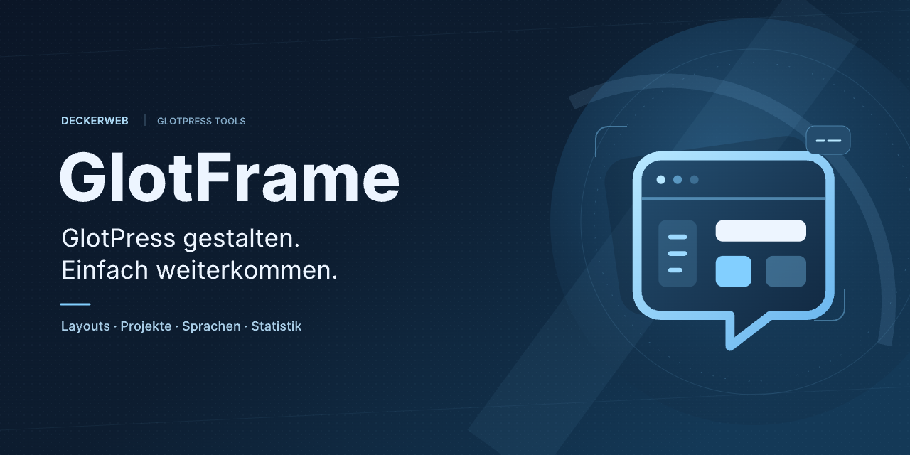
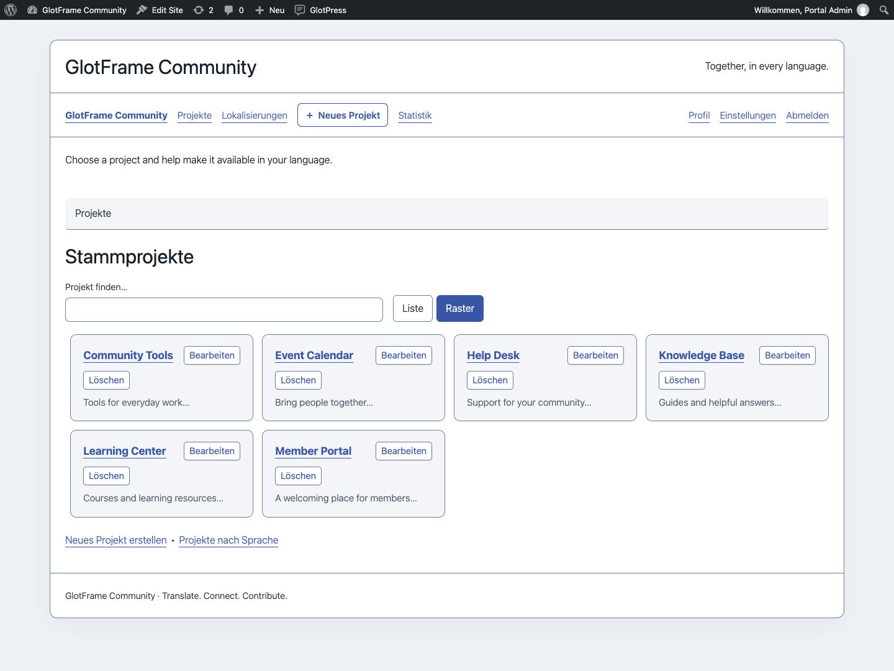
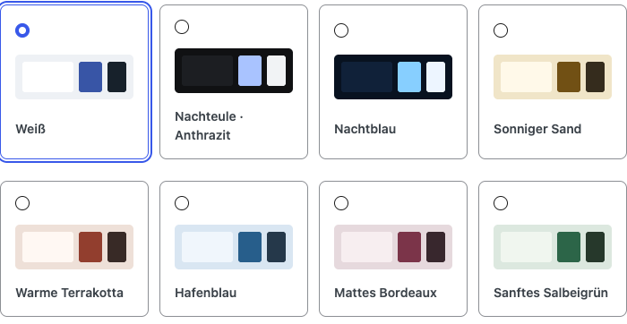
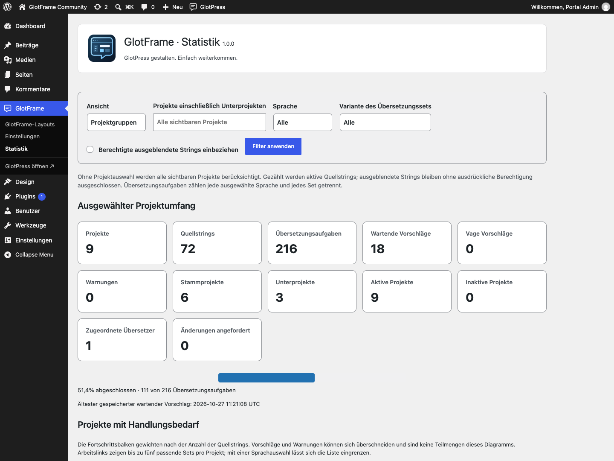

# GlotFrame

## Über GlotFrame

GlotFrame macht GlotPress zu einem individuell gestalteten, übersichtlichen Übersetzungsportal.

Mit Headern und Footern aus WordPress-Blöcken, abgestimmten Designs, besseren Projektansichten und hilfreichen Statistiken entsteht eine Oberfläche, in der sich Übersetzer schnell zurechtfinden. Die Einrichtung gelingt direkt in WordPress – ohne eigene PHP-Anpassungen.

Ein deckerweb Tool für alle, die GlotPress einfacher gestalten und komfortabler nutzen möchten.

**Version 1.0.0** · WordPress 6.4+ · PHP 8.3+ · GlotPress 4.x

[English](README.md) · [Wiki](https://github.com/deckerweb/glotframe/wiki) · [Anleitung](docs/GUIDE-de.md) · [FAQ](docs/FAQ-de.md)

Inhalt: [Über GlotFrame](#über-glotframe) · [Auf einen Blick](#auf-einen-blick) · [Erste Schritte](#erste-schritte) · [Feature-Highlights](#feature-highlights) · [Fragen und Antworten](#fragen-und-antworten) · [Screenshots](#screenshots) · [Änderungsverlauf](#änderungsverlauf)

## Auf einen Blick

- Header und Footer mit WordPress-Blöcken
- Dein Übersetzungsportal, dein Design
- Viele Projekte? Schnell gefunden.
- Kürzere Wege im Übersetzungsalltag
- GlotPress als Startseite
- Fortschritt sichtbar machen
- Deutsch – mit Du oder Sie
- Komfortabel verwalten

## Erste Schritte

1. Prüfe **WordPress 6.4+**, **PHP 8.3+** und **GlotPress 4.x**. Wähle unter **Einstellungen → Permalinks** eine lesbare Struktur; „Einfach“ wird von GlotPress nicht unterstützt.
2. Installiere das GlotFrame-ZIP über **Plugins → Plugin hinzufügen → Plugin hochladen** und aktiviere es. Verwende das bereitgestellte Plugin-ZIP eines Releases statt GitHubs automatisch erzeugtem Quellarchiv.
3. Öffne **GlotFrame → Einstellungen**. Die drei Sprunglinks führen zu Frontend & Layout, Admin & Toolbar sowie Daten & System.
4. Wähle bei den Inhaltszuordnungen **Block-Layout erstellen**. Füge Blöcke hinzu, vergib einen Titel und veröffentliche das Layout. Erstelle bei Bedarf getrennte Layouts für Header und Footer.
5. Wähle die veröffentlichten Layouts unter Header, Footer und Inhalte aus. Bestimme Farbvorlage, Breite und Abstände. Aktiviere GlotFrame und speichere.
6. Öffne **GlotPress ansehen** und prüfe Projektliste, Sprachansicht und Übersetzungseditor, auch auf einem kleinen Bildschirm.

GlotFrame lässt sich ohne GlotPress installieren und aktivieren. Einstellungen und Layouts kannst du vorbereiten und speichern. Abhängige Frontend-Funktionen pausieren mit einem verständlichen Admin-Hinweis; vorhandene Daten bleiben erhalten. Sobald GlotPress 4.x und lesbare Permalinks verfügbar sind, funktionieren sie automatisch wieder. Es gibt keine Aktivierungsweiterleitung aus dem Admin.

## Feature-Highlights

### Header und Footer mit WordPress-Blöcken

Gestalte Header, Footer und Hinweisbereiche direkt im Blockeditor. Sieben Layout-Vorlagen und fünf dynamische GlotPress-Blöcke erleichtern den Einstieg.

### Dein Übersetzungsportal, dein Design

Boxed oder volle Breite, acht Farbvorlagen, eigene Farben und Hintergrundbilder: Gib GlotPress einen passenden Auftritt – mit abgestimmten Formularen, Buttons und übersichtlichen Tabellen.

### Viele Projekte? Schnell gefunden.

Durchsuche Stammprojekte und Unterprojekte und wechsle zwischen Listen- und Rasteransicht. Auch die Auswahl übergeordneter Projekte wird bei langen Listen deutlich komfortabler.

### Kürzere Wege im Übersetzungsalltag

Eine anpassbare Toolbar führt direkt zu Projekten und Unterprojekten. Berechtigte Benutzer erreichen die Funktionen zum Anlegen neuer Projekte bequem aus der Navigation.

### GlotPress als Startseite

Mache deine Website bei Bedarf zum Übersetzungsportal. Verwende GlotPress als Startseite und passe seinen URL-Pfad an.

### Fortschritt sichtbar machen

Kennzahlen, Grafiken und Projektvergleiche zeigen den aktuellen Übersetzungsstand. Betreiber erhalten eine Gesamtübersicht; angemeldete Übersetzer können eigene Beiträge und ausgewählte Projektgruppen betrachten.

### Deutsch – mit Du oder Sie

Wähle die gewünschte Anrede für die deutsche GlotPress-Oberfläche. Die Sprache deiner WordPress-Verwaltung und die eigentlichen Projektübersetzungen bleiben davon unabhängig.

### Komfortabel verwalten

Dupliziere Layouts, behalte ungespeicherte Änderungen im Blick und nutze Site Health sowie passende Befehle in der WordPress-Befehlspalette. In Multisite verwaltet jede Website ihre eigenen Einstellungen und Layouts.

## Fragen und Antworten

### Brauche ich GlotPress?

Ja, für den Übersetzungsbereich wird aktives GlotPress 4.x mit lesbaren Permalinks benötigt. GlotFrame bleibt ohne GlotPress aktivierbar. Einstellungen und Layouts lassen sich vorbereiten und speichern; die abhängigen Funktionen pausieren.

### Wie erstelle ich Header und Footer?

Öffne GlotFrame → Einstellungen → Header, Footer und Inhalte. Erstelle Block-Layouts, veröffentliche sie und wähle sie für die gewünschten Bereiche aus.

### Funktioniert das mit meinem Theme oder Page Builder?

GlotFrame stellt eine eigene Hülle bereit und verwendet WordPress-Blöcke. Inhalte aus Bricks, Elementor oder anderen Page Buildern werden als GlotFrame-Layouts nicht unterstützt.

### Ändert GlotFrame meine Übersetzungen?

Nein. Projekte, Übersetzungen, Berechtigungen, Formulare, Downloads und API-Antworten bleiben bei GlotPress.

### Was bedeuten die Statistikzahlen?

Sie zeigen aktuelle Übersetzungsaufgaben und noch vorhandene Beiträge. Projektquoten werden gewichtet. Es gibt keinen vollständigen Aktivitätsverlauf und kein Qualitätsranking.

### Funktioniert GlotFrame in Multisite?

Ja. Jede Website verwaltet eigene Einstellungen und Layouts, auch bei Netzwerkaktivierung.

### Was passiert beim Deaktivieren oder Löschen?

Deaktivieren erhält alle Daten. Löschen erhält Einstellungen und Layouts standardmäßig. Die optionale Löschfunktion betrifft nur GlotFrame-Inhalte; GlotPress-Daten bleiben erhalten.

[Vollständige Fragen nach Themen](docs/FAQ-de.md).

## Screenshots

Die Stammprojektübersicht auf Raster umschalten.

Aus acht abgestimmten Farbvorlagen wählen.

Betreiberstatistik mit Filtern und Fortschrittsgrafik.

## Änderungsverlauf

### 1.0.0

- **Neu:** Erstveröffentlichung: Header, Footer und Hinweise mit WordPress-Blöcken; sieben Layout-Vorlagen und fünf dynamische GlotPress-Blöcke; Boxed- und Full-Width-Layouts mit acht Farbvorlagen, eigenen Farben und Hintergründen.
- **Verbessert:** Durchsuchbare Projektlisten und Raster, durchsuchbare Auswahl übergeordneter Projekte, übersichtlichere Übersetzungs- und Glossartabellen, anpassbare Toolbar mit Positionswahl sowie optionale Portal-Startseite und eigener URL-Pfad.
- **Sonstiges:** Enthält deutsche Du- und Sie-Oberflächen, aktuelle Betreiber- und persönliche Statistiken, Layout-Verwaltungshilfen, Website-Zustandsdaten und passende Aktionen in der WordPress-Befehlspalette. Erfordert WordPress 6.4, PHP 8.3 und aktives GlotPress 4.x für den Übersetzungsbereich; Einstellungen und Layouts bleiben ohne GlotPress verfügbar.

## Seit 2017 gewachsen. Jetzt in einem Plugin vereint.

Die Wurzeln von GlotFrame reichen bis 2017 zurück. Damals entstanden aus der praktischen Arbeit mit GlotPress zahlreiche Code-Snippets und eigene Templates: für mehr Gestaltungsmöglichkeiten, bessere Übersicht und angenehmere Arbeitsabläufe.

Was im Alltag half, war aufwendig zu pflegen. Die Anpassungen waren über viele einzelne Bausteine verteilt – und mit jedem GlotPress-Update musste geprüft werden, was weiterhin funktionierte und wo nachgebessert werden musste.

GlotFrame bringt diese Grundideen heute in einem vollständig integrierten WordPress-Plugin zusammen und entwickelt sie weiter. Aus individuellen Anpassungen wird ein Werkzeug, mit dem auch Menschen ohne Programmierkenntnisse, Site Builder und Übersetzungsredaktionen schnell ein schönes und gut bedienbares Übersetzungsportal aufbauen können.

GlotPress liefert die Übersetzungsverwaltung. GlotFrame ergänzt, was für einen eigenen Auftritt und einen komfortablen Alltag häufig noch fehlt: Gestaltung, Orientierung und viele durchdachte Details – vereint in einem Paket.

[Fehler und Fragen](https://github.com/deckerweb/glotframe/issues) · [Discussions](https://github.com/deckerweb/glotframe/discussions) · [Vertrauliche Sicherheitsmeldung](SECURITY-de.md)

[Ko-fi](https://ko-fi.com/deckerweb) · [Buy Me a Coffee](https://buymeacoffee.com/daveshine) · [PayPal](https://paypal.me/deckerweb)

Copyright © 2017–2026 David Decker – DECKERWEB. Plugin-Lizenz: GPL v2 oder höher. [Herkunft und Lizenzen Dritter](docs/Third-party-de.md).
