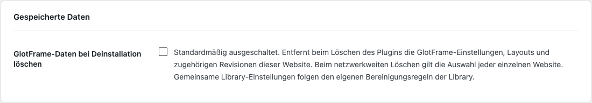
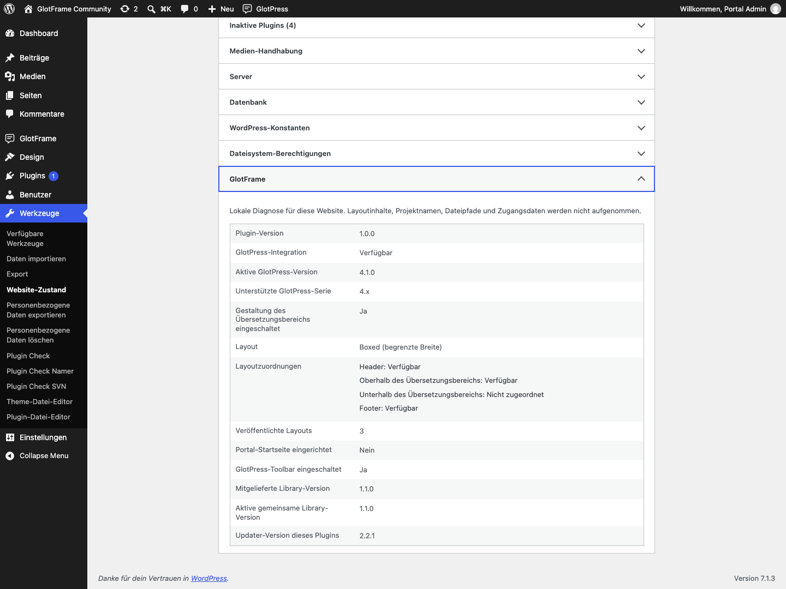
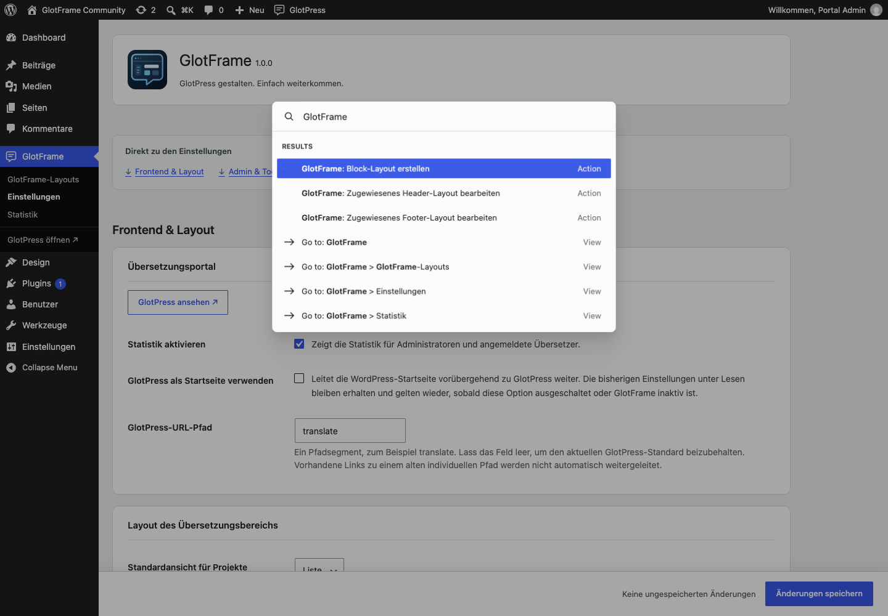

# Verwaltung und Daten

[English](Administration-and-data.md) · [Anleitung](GUIDE-de.md)

## Speichern und Diagnose

Die fixe Speicherleiste zeigt ungespeicherte Änderungen neben dem Button und einen abgesetzten Punkt darin. Werden alle Werte zurückgesetzt, verschwindet der Änderungsstatus. Auf der Einstellungsseite speichert Strg+S unter Windows/Linux beziehungsweise Cmd+S unter macOS mit nativer Eingabeprüfung. Der Blockeditor behält seinen eigenen Speicherablauf. Ohne JavaScript bleibt der normale Speichern-Button nutzbar.

Unter **Werkzeuge → Website-Zustand → Bericht** zeigt GlotFrame Version, Verfügbarkeit, Layoutzuordnungen und Komponentenstatus ohne Layoutinhalte, Projektnamen, Pfade oder Zugangsdaten. Der Statuscheck erkennt sichere Pause und Konfigurationsprobleme ohne externe Abfragen.

Suche in der vorhandenen WordPress-Befehlspalette nach GlotFrame, um ein Block-Layout anzulegen oder gültig zugewiesenen Header/Footer zu bearbeiten. Die Befehle gelten für berechtigte Website-Administratoren in nativ unterstützten Kontexten. Ältere WordPress-Versionen bieten die Palette gegebenenfalls nur im Blockeditor. Es gibt keine zweite Palette und kein zusätzliches Tastenkürzel.

## Berechtigungen und Multisite

Website-Administratoren mit manage_options richten GlotFrame ein und bearbeiten Layouts. Übersetzungs- und Projektaktionen behalten die nativen GlotPress-Rechte. Anmelden allein gewährt keine Projektverwaltung.

Bei Netzwerkaktivierung steht GlotFrame den Websites zur Verfügung, Einstellungen und Layouts bleiben aber pro Website. Es gibt keine netzwerkweite Designvorgabe. Neue Websites erhalten Standardwerte statt fremder Layouts.

## Datenschutz, Updates und Entfernen

GlotFrame verwendet lokale Assets und Systemschriften und ergänzt keine Telemetrie. Der Updater fragt GitHub im WordPress-Updatezyklus ab und übermittelt gewöhnliche Verbindungsdaten wie die IP-Adresse. Der optionale Onlinekatalog der deckerweb Library ist zunächst ausgeschaltet. Andere Dienste von GlotPress oder WordPress behalten ihr eigenes Verhalten.

Deaktivieren erhält Daten. Löschen erhält Einstellungen und Layouts standardmäßig; temporäre Plugin-Caches werden bereinigt. Die optionale Löschfunktion entfernt GlotFrame-Einstellungen, Layouts und Revisionen dieser Website. Netzwerklöschung berücksichtigt die Auswahl jeder Website. GlotPress-Projekte und Übersetzungen werden nie entfernt. Das gemeinsame Library-Cleanup folgt seiner eigenen Letzt-Host-Regel und erhält Daten anderer installierter Hosts.

Optionale Löschung und erhaltene Daten prüfen.

Lokale GlotFrame-Diagnose im Website-Zustand.

GlotFrame-Aktionen in der nativen WordPress-Befehlspalette.
