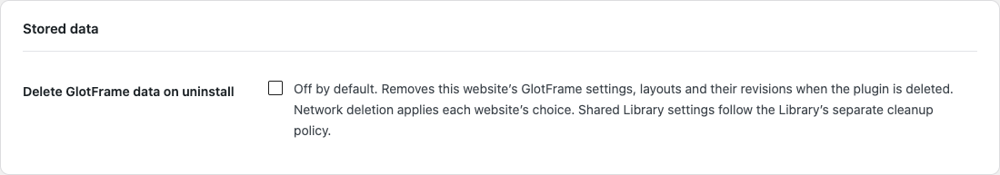
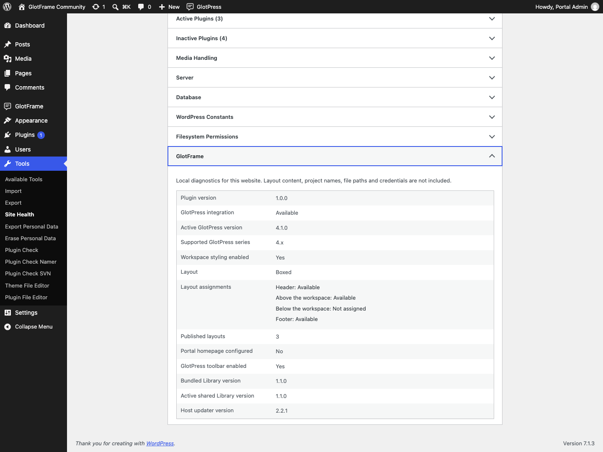
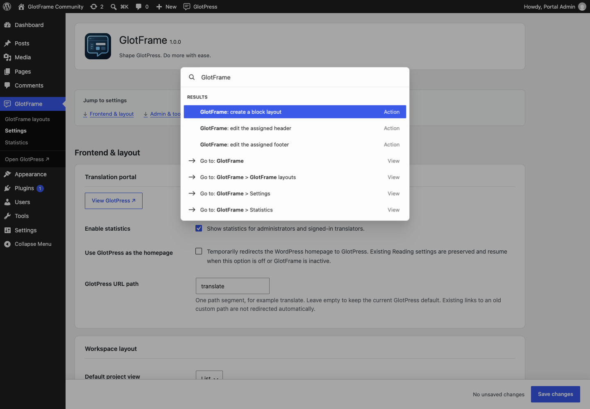

# Administration and data

[Deutsch](Administration-and-data-de.md) · [Guide](GUIDE.md)

## Saving and diagnostics

The fixed save bar shows unsaved changes beside the button and a spaced dot inside it. Returning all values to their original state clears the indicator. Use Ctrl+S on Windows/Linux or Cmd+S on macOS on the settings page; native validation still applies. The block editor retains its own save workflow. Without JavaScript, the standard submit button remains available.

Under **Tools → Site Health → Info**, GlotFrame lists version, runtime availability, layout assignments and component status without layout contents, project names, paths or credentials. Its status check identifies a safe pause and configuration issues without external requests.

Search for GlotFrame in the existing WordPress Command Palette to create a block layout or edit a valid assigned header/footer. Commands are for authorized website administrators in native supported contexts. Older WordPress versions may offer the palette only in the block editor. No second palette or additional shortcut is installed.

## Permissions and Multisite

Website administrators with manage_options configure GlotFrame and edit layouts. Translation and project actions retain native GlotPress permissions. Signing in does not grant project management rights.

Network activation makes GlotFrame available to websites, but settings and layouts remain per website. There is no network-wide design preset. Newly created websites receive defaults rather than another website’s layouts.

## Privacy, updates and removal

GlotFrame uses local assets and system fonts and adds no telemetry. Its updater contacts GitHub during WordPress update checks, sharing ordinary connection data such as the IP address. The optional deckerweb Library online catalog starts disabled. Other GlotPress or WordPress services retain their own behavior.

Deactivation preserves data. Deletion preserves settings and layouts by default; temporary plugin caches are cleaned. The optional delete setting removes this website’s GlotFrame settings, layouts and revisions. Network deletion evaluates each website’s choice. It never removes GlotPress projects or translations. Shared Library cleanup has its own last-host policy and retains data needed by other installed hosts.

Review optional deletion and retained data.

Local GlotFrame diagnostics in Site Health.

GlotFrame actions in the native WordPress Command Palette.
