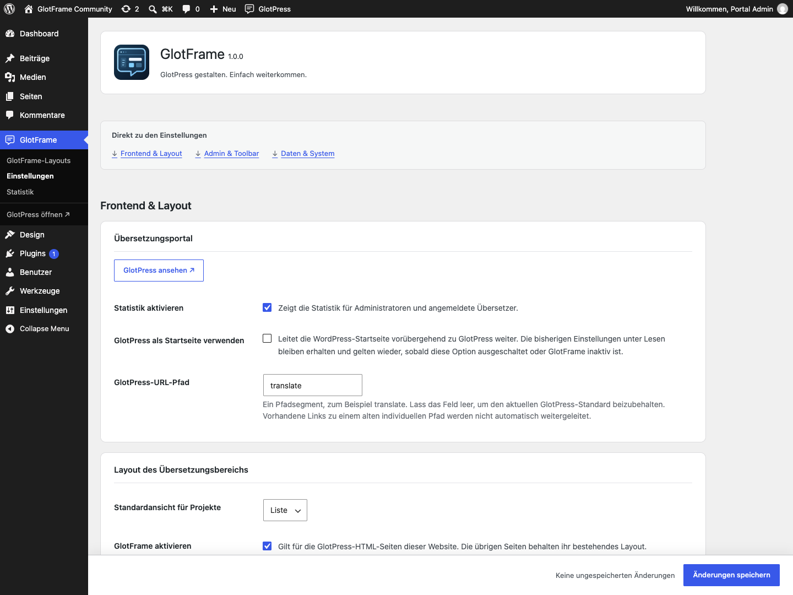
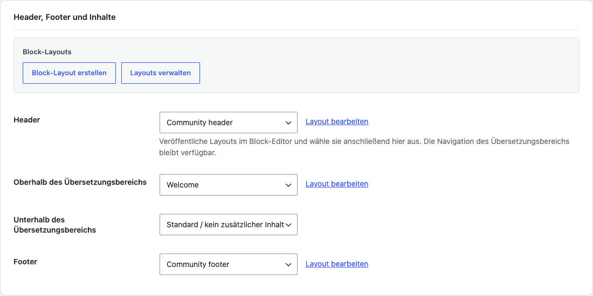
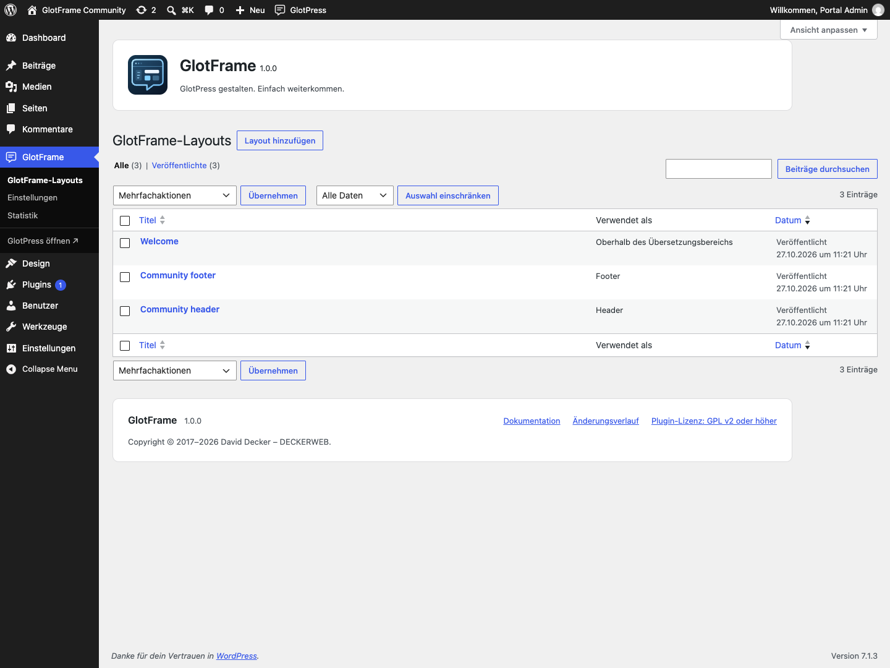
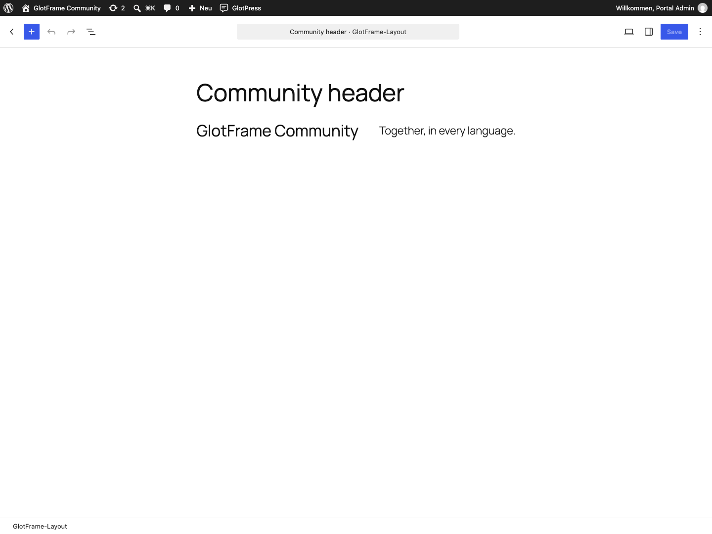
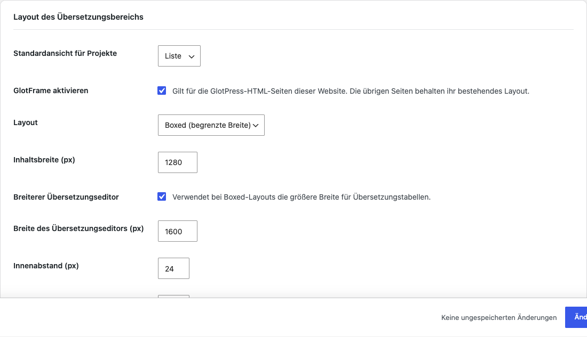
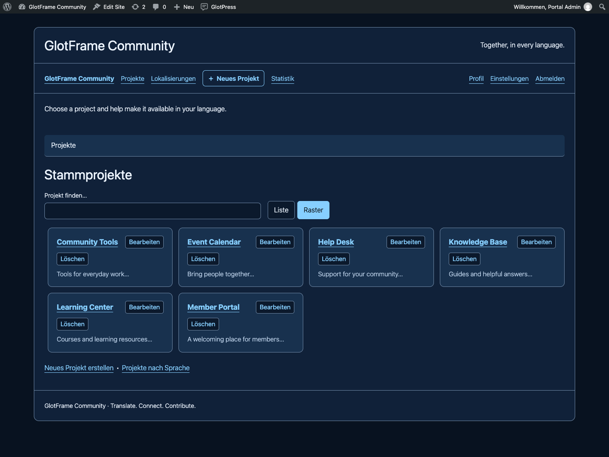
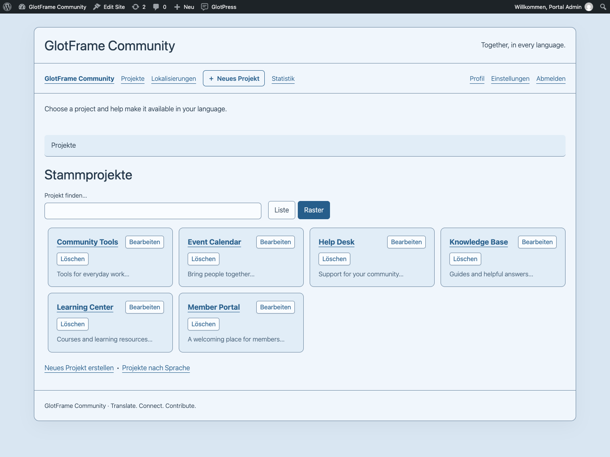
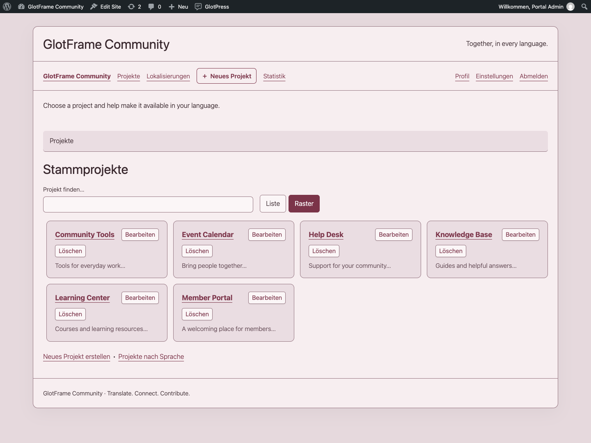
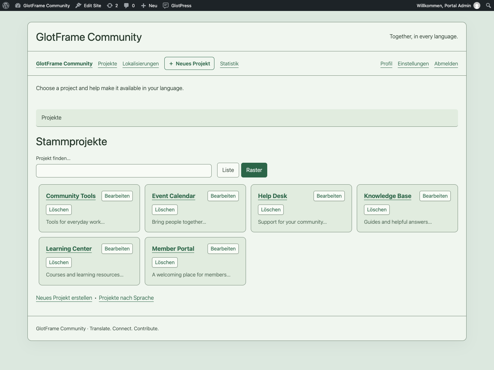
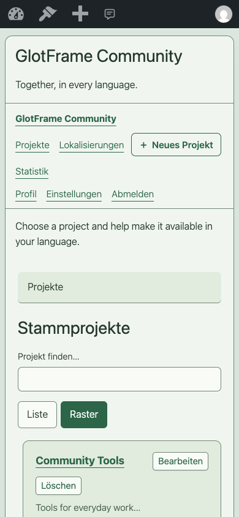

# GlotFrame — Bebilderte Anleitung

[English](GUIDE.md) · [FAQ](FAQ-de.md)

GlotFrame macht GlotPress zu einem individuell gestalteten, übersichtlichen Übersetzungsportal.

Mit Headern und Footern aus WordPress-Blöcken, abgestimmten Designs, besseren Projektansichten und hilfreichen Statistiken entsteht eine Oberfläche, in der sich Übersetzer schnell zurechtfinden. Die Einrichtung gelingt direkt in WordPress – ohne eigene PHP-Anpassungen.

Ein deckerweb Tool für alle, die GlotPress einfacher gestalten und komfortabler nutzen möchten.

## Erste Schritte

1. Prüfe **WordPress 6.4+**, **PHP 8.3+** und **GlotPress 4.x**. Wähle unter **Einstellungen → Permalinks** eine lesbare Struktur; „Einfach“ wird von GlotPress nicht unterstützt.
2. Installiere das GlotFrame-ZIP über **Plugins → Plugin hinzufügen → Plugin hochladen** und aktiviere es. Verwende das bereitgestellte Plugin-ZIP eines Releases statt GitHubs automatisch erzeugtem Quellarchiv.
3. Öffne **GlotFrame → Einstellungen**. Die drei Sprunglinks führen zu Frontend & Layout, Admin & Toolbar sowie Daten & System.
4. Wähle bei den Inhaltszuordnungen **Block-Layout erstellen**. Füge Blöcke hinzu, vergib einen Titel und veröffentliche das Layout. Erstelle bei Bedarf getrennte Layouts für Header und Footer.
5. Wähle die veröffentlichten Layouts unter Header, Footer und Inhalte aus. Bestimme Farbvorlage, Breite und Abstände. Aktiviere GlotFrame und speichere.
6. Öffne **GlotPress ansehen** und prüfe Projektliste, Sprachansicht und Übersetzungseditor, auch auf einem kleinen Bildschirm.

GlotFrame lässt sich ohne GlotPress installieren und aktivieren. Einstellungen und Layouts kannst du vorbereiten und speichern. Abhängige Frontend-Funktionen pausieren mit einem verständlichen Admin-Hinweis; vorhandene Daten bleiben erhalten. Sobald GlotPress 4.x und lesbare Permalinks verfügbar sind, funktionieren sie automatisch wieder. Es gibt keine Aktivierungsweiterleitung aus dem Admin.

Beispiel aus einer lokalen Demo-Installation.

Beispiel aus einer lokalen Demo-Installation.

Beispiel aus einer lokalen Demo-Installation.

## Layouts und Design

## Layouts erstellen und zuordnen

Erstelle Layouts im WordPress-Blockeditor. Die vier Bereiche sind Header, Inhalte oberhalb des Übersetzungsbereichs, Inhalte darunter und Footer. Die native GlotPress-Navigation bleibt verfügbar. Angezeigt werden nur veröffentlichte Layouts ohne Passwortschutz. Entwürfe, private Layouts und Inhalte im Papierkorb bleiben verborgen.

Die Spalte **Verwendet als** zeigt alle Zuordnungen. **Als Entwurf duplizieren** erzeugt eine unabhängige Kopie, ohne das Original zu verändern oder die Kopie zuzuordnen. **Layout bearbeiten** öffnet die aktuelle Auswahl direkt. Speichere Zuordnungen auf der Einstellungsseite; Inhaltsänderungen veröffentlichst du im Editor.

Nicht verfügbare Zuordnungen werden gekennzeichnet. Stelle die Veröffentlichung vor dem Speichern wieder her, wähle Ersatz oder speichere zum Entfernen der ungültigen Zuordnung. Patterns ersetzen vorhandene Layouts nie automatisch.

## Vorlagen und dynamische Blöcke

Öffne die Blockauswahl: Unter **GlotFrame-Layouts** findest du sieben Startvorlagen; unter **GlotFrame** die fünf Blöcke Projektübersicht, Aktuelles Projekt, Projektaktionen, Übersetzungsfortschritt und Projektgruppenstatistik. Wähle für kontextabhängige Vorschauen ein Projekt in den Blockeinstellungen. Projektaktionen beachten die nativen Berechtigungen. Die Gruppenstatistik berücksichtigt das gewählte Projekt und seine Unterprojekte.

## Farben, Breite und Abstände

Bei Boxed bleibt außen Hintergrund sichtbar; volle Breite bietet mehr horizontalen Platz. Die Inhaltsbreite gilt für gewöhnliche Seiten. Der optional breitere Übersetzungseditor verwendet seine eigene Breite. Innenabstand, Eckenradius, Systemschrift, Schriftgröße und Tabellendichte sind einstellbar.

Acht Farbvorlagen stehen bereit: Weiß, Nachteule · Anthrazit, Nachtblau, Sonniger Sand, Warme Terrakotta, Hafenblau, Mattes Bordeaux und Sanftes Salbeigrün. Eine Auswahl füllt die Farbfelder; vor dem Speichern kannst du sie anpassen. Layouts, Breiten und Hintergrundbilder werden dabei nicht ersetzt. Nutze den WordPress-Farbwähler und die Mediathek für lokale Hintergründe. Prüfe nach eigenen Farbanpassungen Texte, Links, Bedienelemente und Tastaturfokus.

## Page Builder

Erstelle und bearbeite GlotFrame-Layouts mit dem WordPress-Blockeditor. Mit Bricks, Elementor oder anderen Page Buildern erstellte Layout-Inhalte werden nicht unterstützt. Ein vorhandener Builder-Bearbeitungsbutton bedeutet nicht, dass dessen Inhalte in GlotFrame ausgegeben werden können. Das aktive Theme muss keinen Portal-Header oder -Footer bereitstellen.

Beispiel aus einer lokalen Demo-Installation.

Beispiel aus einer lokalen Demo-Installation.

Beispiel aus einer lokalen Demo-Installation.

Beispiel aus einer lokalen Demo-Installation.

Beispiel aus einer lokalen Demo-Installation.

Beispiel aus einer lokalen Demo-Installation.

Beispiel aus einer lokalen Demo-Installation.

Beispiel aus einer lokalen Demo-Installation.

Beispiel aus einer lokalen Demo-Installation.

Beispiel aus einer lokalen Demo-Installation.

## Projekte und Übersetzung

## Projekte finden

Stammprojekte und Unterprojekte erhalten Suche und Liste/Raster-Umschaltung. Die Suche filtert die angezeigte Sammlung; sie durchsucht keine Übersetzungsstrings. Die Ansichtspräferenz bleibt bei verfügbarem lokalem Speicher in diesem Browser erhalten. Beschreibungen und Bearbeitungslinks gehören weiterhin zum jeweiligen Projekt.

Die native Auswahl übergeordneter Projekte ist durchsuchbar und zeigt Projektpfade. So lassen sich gleichnamige Projekte in verschiedenen Zweigen unterscheiden. Ohne JavaScript bleiben die nativen GlotPress-Bedienelemente nutzbar.

## Aktionen und Editor

Berechtigte Benutzer erreichen Neues Projekt in der Navigation des Übersetzungsbereichs und der Toolbar. Beim aktuellen Projekt gibt es außerdem einen Unterprojekt-Link. Geöffnet werden die nativen GlotPress-Formulare mit ihren Berechtigungen und Eingabeprüfungen. Projektaktionen klappen unterhalb des Schalters auf und reservieren keine seitliche Spalte.

Übersetzungstabellen erhalten wechselnde Zeilenhintergründe, Hover-Rückmeldung, die kompakte Prio-Überschrift, feste Checkboxbreiten, angenehmere Innenabstände und getrennte Navigation, Legende und Exportfunktionen. Details und Abbrechen verwenden den nativen Editorablauf. Exportformate und Übersetzungsdaten bleiben unter Kontrolle von GlotPress.

## Sprachen und Glossare

Die Sprachübersicht hat ausgerichtete Spalten und den nativen Sprachfilter. Sprachbezogene Projekttabellen trennen Projektinformationen, Übersetzungssätze und Zahlen. Glossare zeigen Begriffe, Wortarten, Übersetzungen und Kommentare mit klareren Zeilenabständen. Berechtigungen und gespeicherte Glossareinträge werden nicht verändert.

## Deutsche Oberfläche mit Du oder Sie

Wähle unter **GlotPress-Oberflächensprache**: WordPress-Sprache übernehmen, Deutsch mit Du oder Deutsch mit Sie. Mitgelieferte offizielle GlotPress-4.1.0-Kataloge decken PHP und JavaScript ab. Die Auswahl betrifft nur GlotPress, weder den WordPress-Admin noch Projektübersetzungen. Unbekannte Texte von Erweiterungen oder anderen GlotPress-Versionen verwenden den nativen Fallback.

Beispiel aus einer lokalen Demo-Installation.

Beispiel aus einer lokalen Demo-Installation.

Beispiel aus einer lokalen Demo-Installation.

Beispiel aus einer lokalen Demo-Installation.

Beispiel aus einer lokalen Demo-Installation.

Beispiel aus einer lokalen Demo-Installation.

Beispiel aus einer lokalen Demo-Installation.

Beispiel aus einer lokalen Demo-Installation.

Beispiel aus einer lokalen Demo-Installation.

## Portal und Toolbar

## Portal-Startseite und URL-Pfad

Aktiviere **GlotPress als Startseite verwenden**, wenn die Website vor allem Übersetzungen dient. Geeignete GET-/HEAD-Aufrufe der Startseite werden vorübergehend zu GlotPress weitergeleitet. WordPress-Admin und andere Seiten bleiben erreichbar. Die Einstellungen unter Lesen bleiben erhalten und gelten nach Abschalten der Option oder des Plugins wieder. Einstellungsseite und Dashboard kennzeichnen das aktive Portal.

Der individuelle URL-Pfad akzeptiert ein Segment, zum Beispiel translate. Leer bleibt der aktuelle GlotPress-Standard erhalten. Reservierte Pfade und bekannte Inhaltskonflikte werden abgewiesen. Alte individuelle Pfade werden nicht automatisch weitergeleitet: Passe Menüs und Lesezeichen nach einer Änderung an.

## Toolbar

Der GlotPress-Eintrag ist standardmäßig für angemeldete Benutzer mit sichtbarer WordPress-Toolbar aktiviert. Bestimme Beschriftung und Icon, zeige Stammprojekte, ergänze optional Unterprojekte und wähle eine Tiefe von eins bis sechs Ebenen. Sechzehn SVG-Motive stehen bereit, mit dem WordPress-Symbol als Fallback.

Wähle Standardposition, Anfang oder Ende links, rechte Gruppe oder vor/nach einem vorhandenen Eintrag. Wähle ein tatsächlich vorhandenes Bezugsziel. Fehlt es auf einer anderen Seite, nutzt GlotFrame die Standardposition. Position und Name sind Website-Einstellungen, keine persönlichen Präferenzen. Das letzte Admin-Untermenü öffnet GlotPress in einem neuen Tab.

Beispiel aus einer lokalen Demo-Installation.

## Statistik

Öffne **GlotFrame → Statistik** für die Betreiberübersicht. Angemeldete Übersetzer erreichen die Frontend-Statistik über Navigation oder Toolbar. Wähle eigene Beiträge oder Projektgruppen und grenze Projekte, Sprache und Übersetzungssatz ein. Ein gewähltes Projekt umfasst seine Unterprojekte.

Karten, Fortschrittsgrafik und Projekt-Sprach-Matrix zeigen den aktuellen Stand. Die Gesamtquote wird anhand der Ausgangsstrings pro Übersetzungssatz gewichtet, nicht aus Projektprozenten gemittelt. Ein Ausgangsstring in drei Sprachsätzen ergibt drei Übersetzungsaufgaben. Leere Projekte erzeugen keine irreführenden 100 %.

Wartende Vorschläge und Warnungen können andere Zahlen überlappen; sie sind keine zusätzlichen Tortenstücke. Standard sind aktive öffentliche Strings. Ausgeblendete Strings erfordern native GlotPress-Berechtigung.

Persönliche Beiträge zählen noch vorhandene, dem angemeldeten Benutzer zugeordnete Datensätze. Ihr Datumsfilter betrifft das gespeicherte Einreichungsdatum, nicht die Gesamtquote. Importe, überschriebene oder gelöschte Datensätze beeinflussen die Aussagekraft. Dies ist kein vollständiger Aktivitätsverlauf, Produktivitätswert oder Qualitätsranking.

Es entstehen keine Verlaufstabelle, Hintergrundverfolgung oder Analyseverbindung. Der Berechnungszeitpunkt wird angezeigt. Der Block Projektgruppenstatistik bringt eine kompakte Zusammenfassung der gewählten Gruppe in ein Layout.

Beispiel aus einer lokalen Demo-Installation.

Beispiel aus einer lokalen Demo-Installation.

## Verwaltung und Daten

## Speichern und Diagnose

Die fixe Speicherleiste zeigt ungespeicherte Änderungen neben dem Button und einen abgesetzten Punkt darin. Werden alle Werte zurückgesetzt, verschwindet der Änderungsstatus. Auf der Einstellungsseite speichert Strg+S unter Windows/Linux beziehungsweise Cmd+S unter macOS mit nativer Eingabeprüfung. Der Blockeditor behält seinen eigenen Speicherablauf. Ohne JavaScript bleibt der normale Speichern-Button nutzbar.

Unter **Werkzeuge → Website-Zustand → Bericht** zeigt GlotFrame Version, Verfügbarkeit, Layoutzuordnungen und Komponentenstatus ohne Layoutinhalte, Projektnamen, Pfade oder Zugangsdaten. Der Statuscheck erkennt sichere Pause und Konfigurationsprobleme ohne externe Abfragen.

Suche in der vorhandenen WordPress-Befehlspalette nach GlotFrame, um ein Block-Layout anzulegen oder gültig zugewiesenen Header/Footer zu bearbeiten. Die Befehle gelten für berechtigte Website-Administratoren in nativ unterstützten Kontexten. Ältere WordPress-Versionen bieten die Palette gegebenenfalls nur im Blockeditor. Es gibt keine zweite Palette und kein zusätzliches Tastenkürzel.

## Berechtigungen und Multisite

Website-Administratoren mit manage_options richten GlotFrame ein und bearbeiten Layouts. Übersetzungs- und Projektaktionen behalten die nativen GlotPress-Rechte. Anmelden allein gewährt keine Projektverwaltung.

Bei Netzwerkaktivierung steht GlotFrame den Websites zur Verfügung, Einstellungen und Layouts bleiben aber pro Website. Es gibt keine netzwerkweite Designvorgabe. Neue Websites erhalten Standardwerte statt fremder Layouts.

## Datenschutz, Updates und Entfernen

GlotFrame verwendet lokale Assets und Systemschriften und ergänzt keine Telemetrie. Der Updater fragt GitHub im WordPress-Updatezyklus ab und übermittelt gewöhnliche Verbindungsdaten wie die IP-Adresse. Der optionale Onlinekatalog der deckerweb Library ist zunächst ausgeschaltet. Andere Dienste von GlotPress oder WordPress behalten ihr eigenes Verhalten.

Deaktivieren erhält Daten. Löschen erhält Einstellungen und Layouts standardmäßig; temporäre Plugin-Caches werden bereinigt. Die optionale Löschfunktion entfernt GlotFrame-Einstellungen, Layouts und Revisionen dieser Website. Netzwerklöschung berücksichtigt die Auswahl jeder Website. GlotPress-Projekte und Übersetzungen werden nie entfernt. Das gemeinsame Library-Cleanup folgt seiner eigenen Letzt-Host-Regel und erhält Daten anderer installierter Hosts.

Beispiel aus einer lokalen Demo-Installation.

Beispiel aus einer lokalen Demo-Installation.

