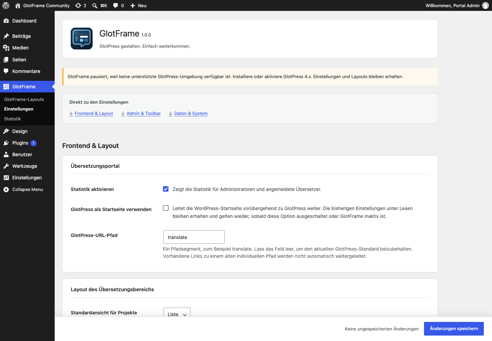

# Erste Schritte

[English](Getting-started.md) · [Anleitung](GUIDE-de.md)

1. Prüfe **WordPress 6.4+**, **PHP 8.3+** und **GlotPress 4.x**. Wähle unter **Einstellungen → Permalinks** eine lesbare Struktur; „Einfach“ wird von GlotPress nicht unterstützt.
2. Installiere das GlotFrame-ZIP über **Plugins → Plugin hinzufügen → Plugin hochladen** und aktiviere es. Verwende das bereitgestellte Plugin-ZIP eines Releases statt GitHubs automatisch erzeugtem Quellarchiv.
3. Öffne **GlotFrame → Einstellungen**. Die drei Sprunglinks führen zu Frontend & Layout, Admin & Toolbar sowie Daten & System.
4. Wähle bei den Inhaltszuordnungen **Block-Layout erstellen**. Füge Blöcke hinzu, vergib einen Titel und veröffentliche das Layout. Erstelle bei Bedarf getrennte Layouts für Header und Footer.
5. Wähle die veröffentlichten Layouts unter Header, Footer und Inhalte aus. Bestimme Farbvorlage, Breite und Abstände. Aktiviere GlotFrame und speichere.
6. Öffne **GlotPress ansehen** und prüfe Projektliste, Sprachansicht und Übersetzungseditor, auch auf einem kleinen Bildschirm.

GlotFrame lässt sich ohne GlotPress installieren und aktivieren. Einstellungen und Layouts kannst du vorbereiten und speichern. Abhängige Frontend-Funktionen pausieren mit einem verständlichen Admin-Hinweis; vorhandene Daten bleiben erhalten. Sobald GlotPress 4.x und lesbare Permalinks verfügbar sind, funktionieren sie automatisch wieder. Es gibt keine Aktivierungsweiterleitung aus dem Admin.

Einstellungsübersicht mit drei klaren Bereichen.

Veröffentlichte Layouts zuordnen und direkt bearbeiten.

Die Stammprojektübersicht auf Raster umschalten.

GlotFrame-Einstellungen vorbereiten, während GlotPress pausiert.
