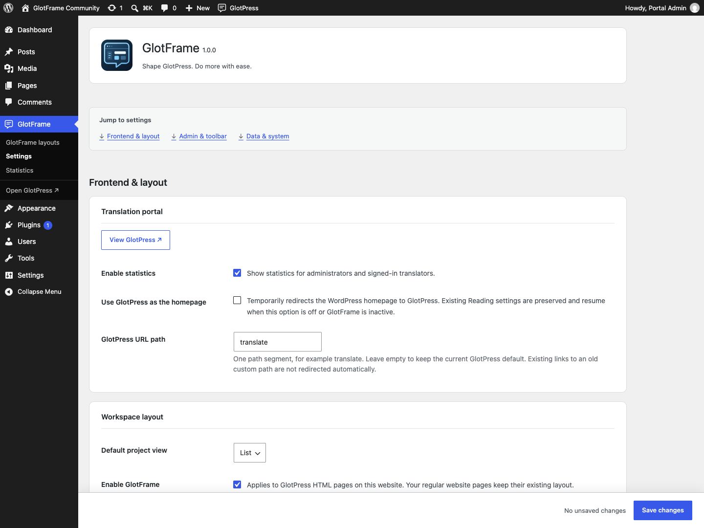
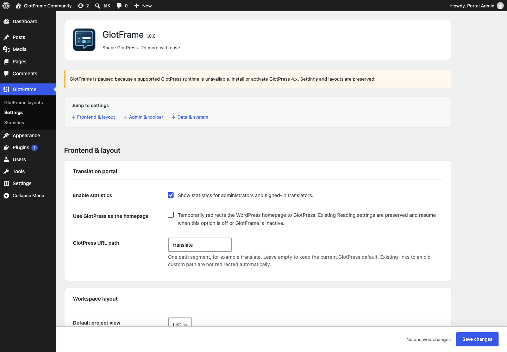

# Getting started

[Deutsch](Getting-started-de.md) · [Guide](GUIDE.md)

1. Check **WordPress 6.4+**, **PHP 8.3+** and **GlotPress 4.x**. Choose a readable permalink structure in **Settings → Permalinks**; Plain is not supported by GlotPress.
2. Install the GlotFrame ZIP through **Plugins → Add Plugin → Upload Plugin** and activate it. Use the packaged ZIP supplied with a release, rather than GitHub’s automatic source archive.
3. Open **GlotFrame → Settings**. The three jump links lead to Frontend & Layout, Admin & Toolbar, and Data & System.
4. Beside the content assignments, choose **Create block layout**. Add blocks, give the layout a title and publish it. Create separate layouts for the header and footer if needed.
5. Select the published layouts under Header, footer and content. Choose a preset, width and spacing. Enable GlotFrame and save.
6. Use **View GlotPress** and check the project list, an individual language and the translation editor, including on a small screen.

GlotFrame can be installed and activated without GlotPress. You can prepare and save settings and layouts. Dependent frontend functions pause, an admin notice explains why, and stored data is preserved. They resume automatically when GlotPress 4.x and readable permalinks are available. There is no activation redirect out of the administration area.

Settings overview with three grouped sections.

Assign published layouts and open them for editing.

Switch the root-project overview to grid view.

Prepare GlotFrame settings while GlotPress is paused.
