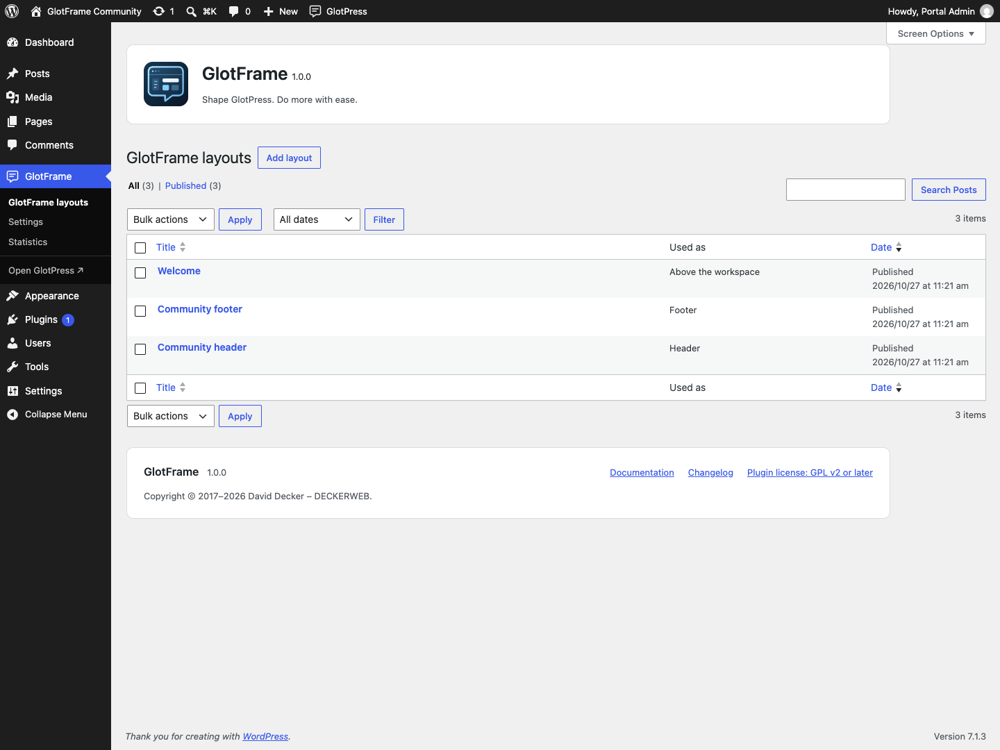
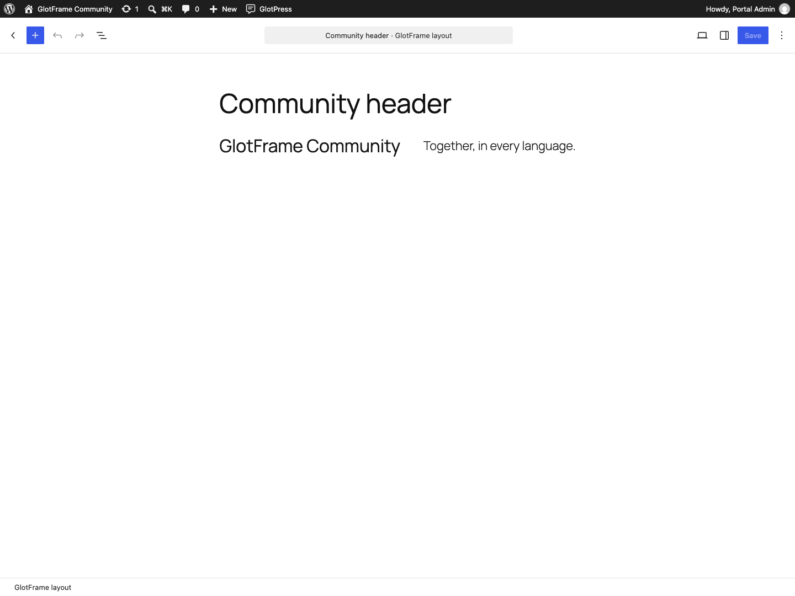
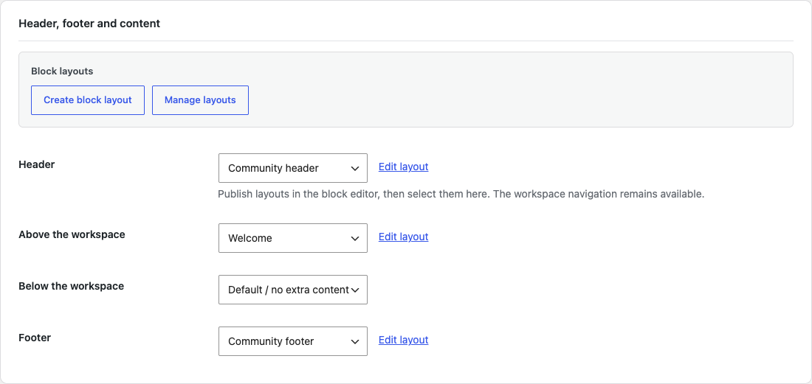
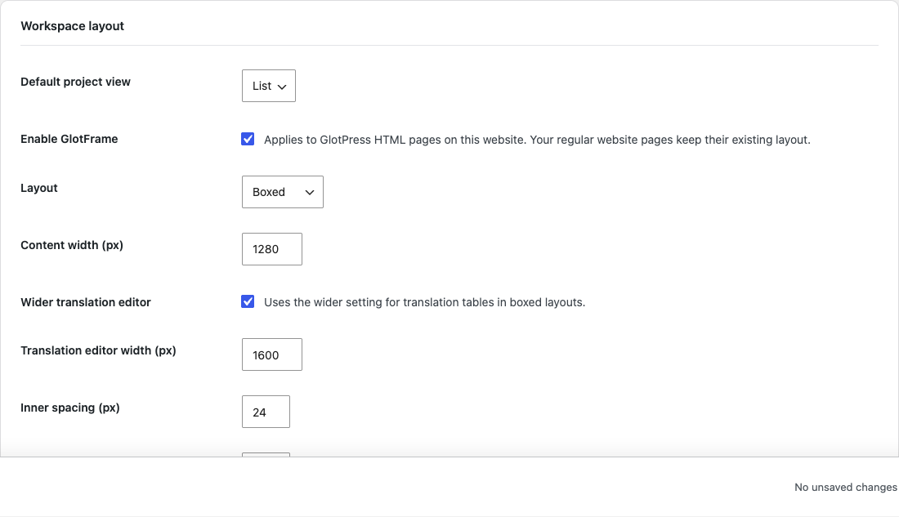
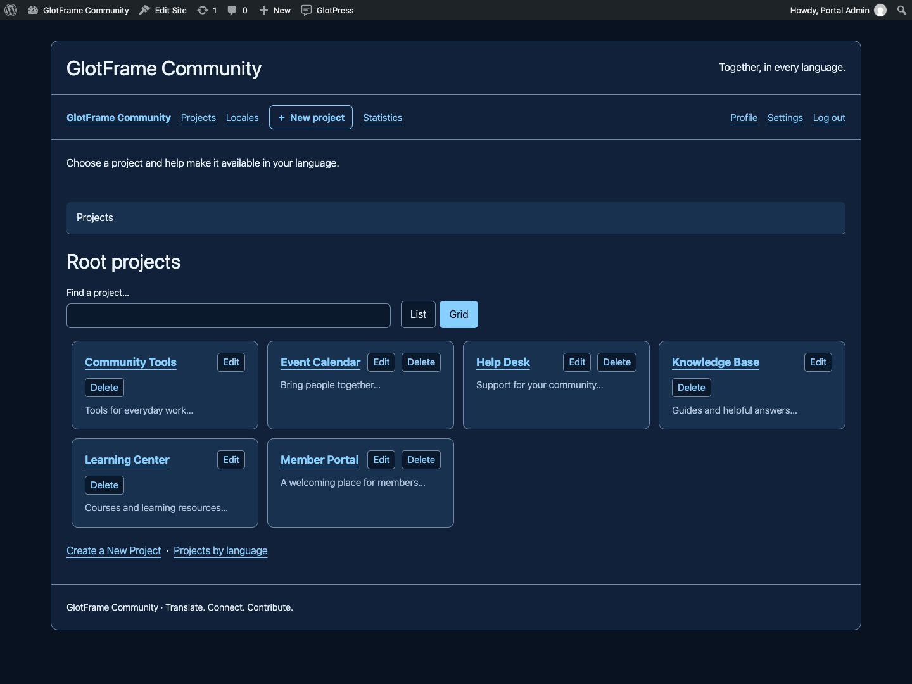
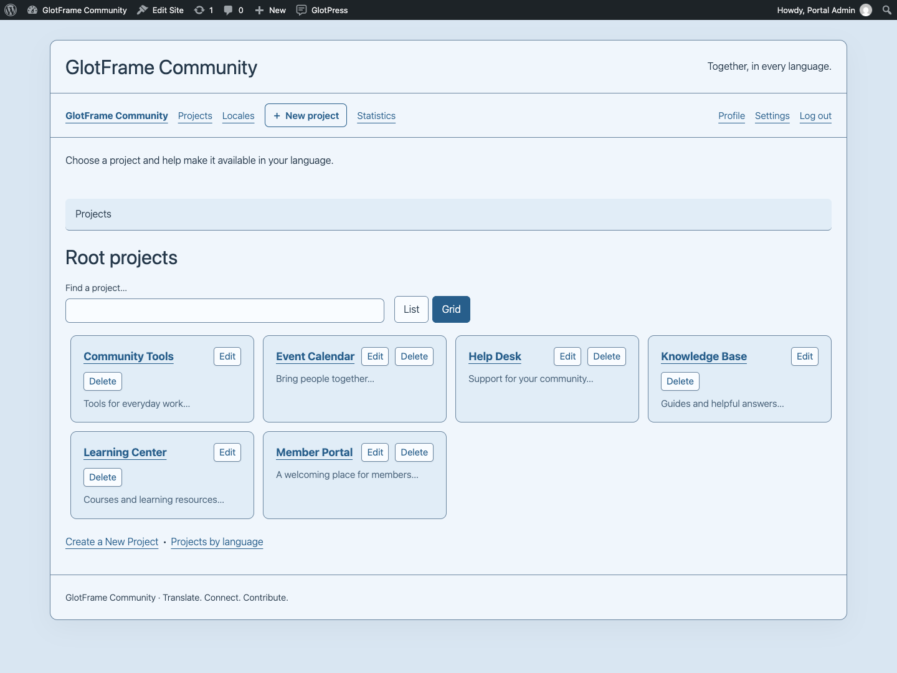
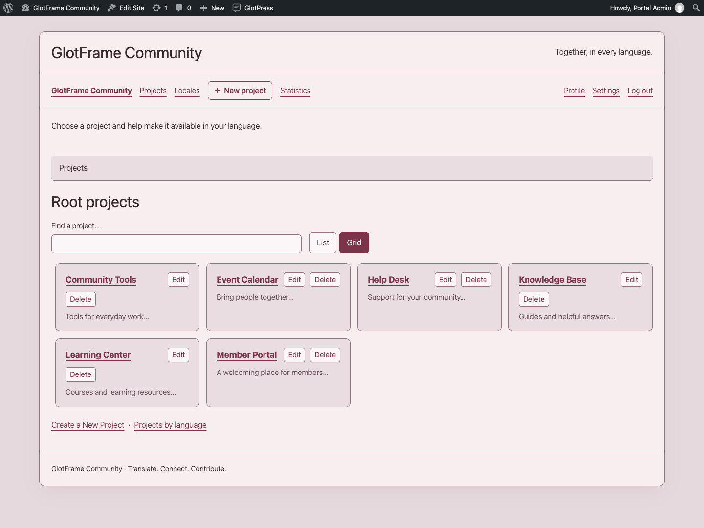
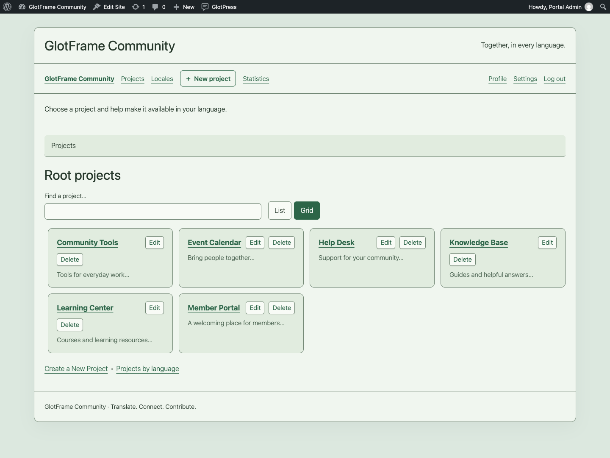
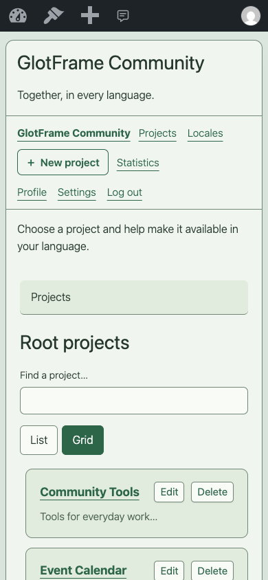

# Layouts and design

[Deutsch](Layouts-and-design-de.md) · [Guide](GUIDE.md)

## Build and assign layouts

Create layouts in the WordPress block editor. The four regions are header, content above the workspace, content below the workspace, and footer. Native GlotPress navigation remains available. Only published layouts without password protection are displayed. Draft, private and trashed layouts stay hidden.

The layout overview’s **Used as** column shows all assignments. **Duplicate as draft** creates an independent copy without changing the original or assigning the copy. **Edit layout** opens the selected layout directly. Save assignment changes on the settings page; publish content changes in the editor.

An unavailable assignment is labeled clearly. Restore publication before saving, choose a replacement, or save to clear it. Existing layouts are never replaced by patterns automatically.

## Patterns and dynamic blocks

Open the block inserter: **GlotFrame layouts** contains seven starting patterns; **GlotFrame** contains Project overview, Current project, Project actions, Translation progress and Project group statistics. Choose a project in the block settings for context-dependent previews. Project actions respect native permissions. Group statistics show the selected project and its descendants.

## Color, width and spacing

Choose boxed output for a visible outer background or full width for more horizontal space. Content width controls ordinary pages; the optional wider translation editor uses its separate width. Inner padding, corner radius, system font, text size and table density can be adjusted.

Eight presets are available: White, Night owl · Charcoal, Midnight blue, Sunlit sand, Warm terracotta, Harbor blue, Muted Bordeaux and Soft sage. Selecting a preset fills its color controls; adjust them before saving. It does not replace layouts, widths or background images. Use the WordPress color picker and Media Library for local backgrounds. Check text, links, controls and keyboard focus after customizing colors.

## Page builders

Create and edit GlotFrame layouts with the WordPress block editor. Layout content created with Bricks, Elementor or other page builders is not supported. A builder edit button does not imply that its content can be displayed by GlotFrame. The active theme is not required to provide the portal header or footer.

Example from a local demo installation.

Example from a local demo installation.

Example from a local demo installation.

Example from a local demo installation.

Example from a local demo installation.

Example from a local demo installation.

Example from a local demo installation.

Example from a local demo installation.

Example from a local demo installation.

Example from a local demo installation.

