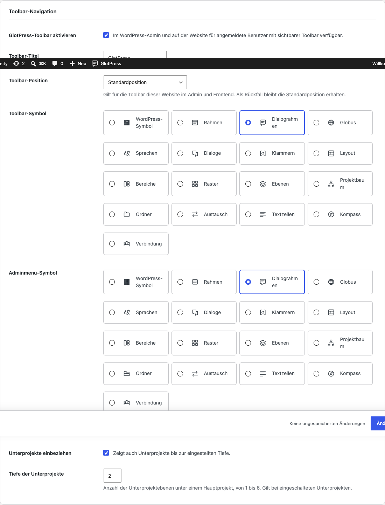

# Portal und Toolbar

[English](Portal-and-toolbar.md) · [Anleitung](GUIDE-de.md)

## Portal-Startseite und URL-Pfad

Aktiviere **GlotPress als Startseite verwenden**, wenn die Website vor allem Übersetzungen dient. Geeignete GET-/HEAD-Aufrufe der Startseite werden vorübergehend zu GlotPress weitergeleitet. WordPress-Admin und andere Seiten bleiben erreichbar. Die Einstellungen unter Lesen bleiben erhalten und gelten nach Abschalten der Option oder des Plugins wieder. Einstellungsseite und Dashboard kennzeichnen das aktive Portal.

Der individuelle URL-Pfad akzeptiert ein Segment, zum Beispiel translate. Leer bleibt der aktuelle GlotPress-Standard erhalten. Reservierte Pfade und bekannte Inhaltskonflikte werden abgewiesen. Alte individuelle Pfade werden nicht automatisch weitergeleitet: Passe Menüs und Lesezeichen nach einer Änderung an.

## Toolbar

Der GlotPress-Eintrag ist standardmäßig für angemeldete Benutzer mit sichtbarer WordPress-Toolbar aktiviert. Bestimme Beschriftung und Icon, zeige Stammprojekte, ergänze optional Unterprojekte und wähle eine Tiefe von eins bis sechs Ebenen. Sechzehn SVG-Motive stehen bereit, mit dem WordPress-Symbol als Fallback.

Wähle Standardposition, Anfang oder Ende links, rechte Gruppe oder vor/nach einem vorhandenen Eintrag. Wähle ein tatsächlich vorhandenes Bezugsziel. Fehlt es auf einer anderen Seite, nutzt GlotFrame die Standardposition. Position und Name sind Website-Einstellungen, keine persönlichen Präferenzen. Das letzte Admin-Untermenü öffnet GlotPress in einem neuen Tab.

Beispiel aus einer lokalen Demo-Installation.

