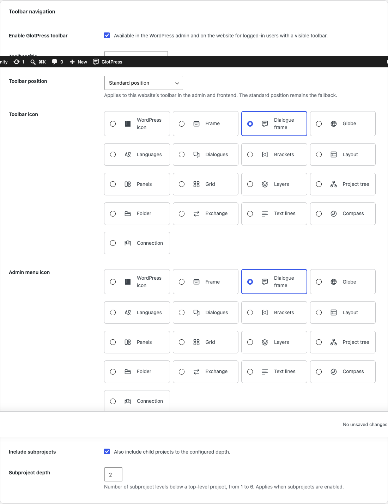

# Portal and toolbar

[Deutsch](Portal-and-toolbar-de.md) · [Guide](GUIDE.md)

## Portal homepage and URL path

Enable **Use GlotPress as the homepage** if the website primarily serves translation work. It temporarily redirects eligible homepage GET/HEAD requests to GlotPress. WordPress administration and other pages remain reachable. Existing Reading settings are preserved and apply again when the option or plugin is disabled. The settings page and dashboard identify the active portal.

The custom URL path accepts one segment, such as translate. Leave it empty to keep the current GlotPress default. Reserved paths and known content conflicts are rejected. Links to an old custom path are not redirected automatically: update menus and bookmarks after changing it.

## Toolbar

The GlotPress entry is enabled by default for signed-in users with a visible WordPress toolbar. Set its label and icon, show root projects, optionally include subprojects and choose a depth from one to six levels. Sixteen SVG motifs are available, with the WordPress symbol as fallback.

Choose the standard position, first or last on the left, the right group, or before/after an existing entry. Select a reference that is actually present. If that reference is missing on another page, GlotFrame uses its standard placement. Position and label are website settings, not personal preferences. The final admin submenu opens GlotPress in a new tab.

Configure toolbar identity, projects, depth and placement.
