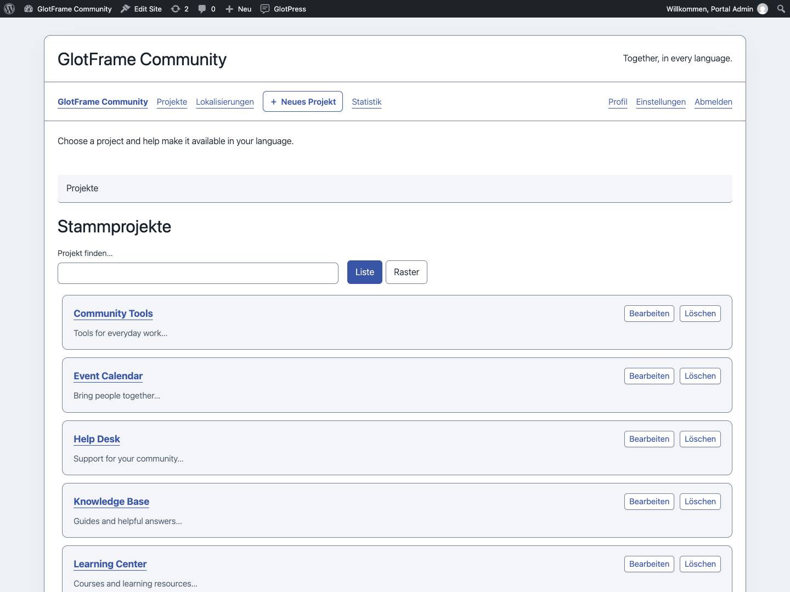
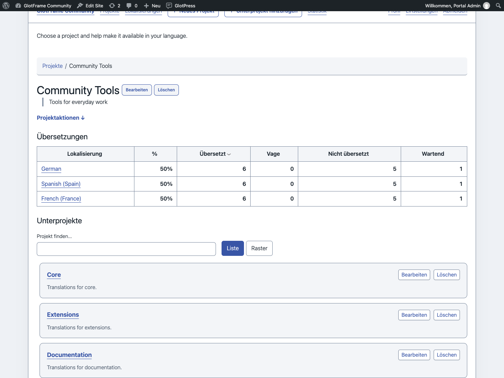
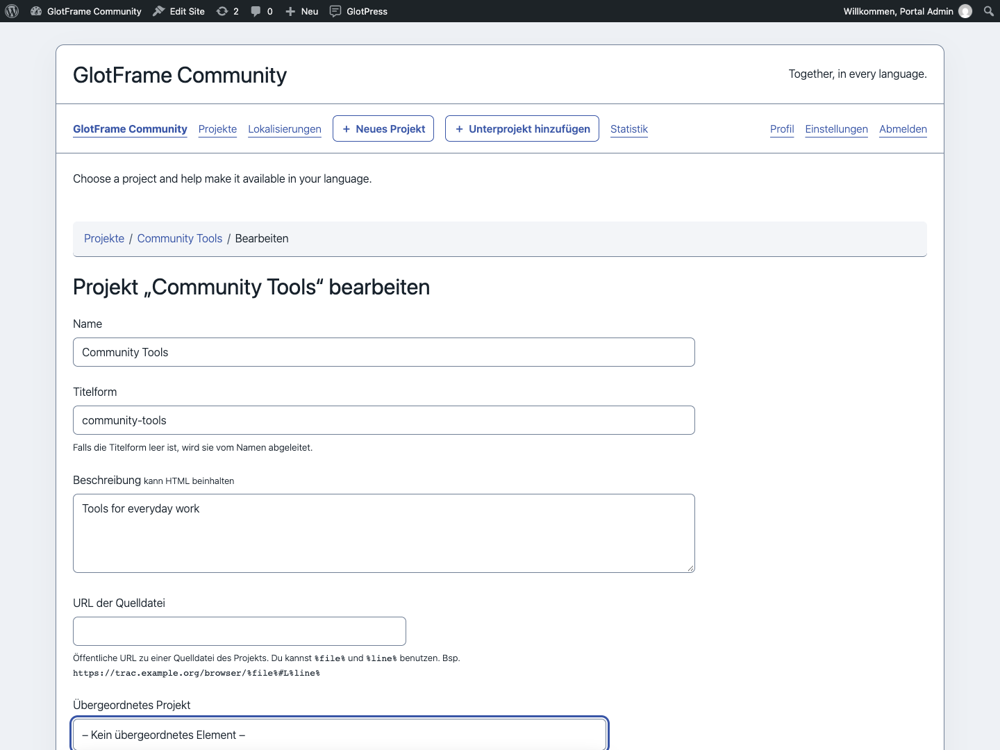
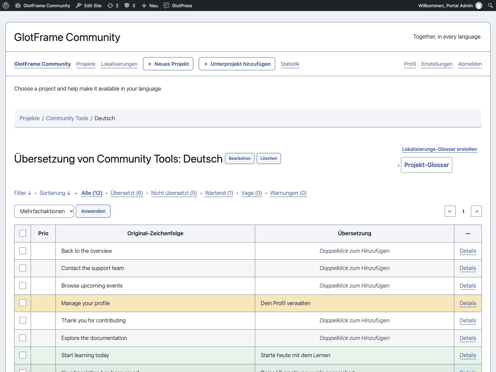
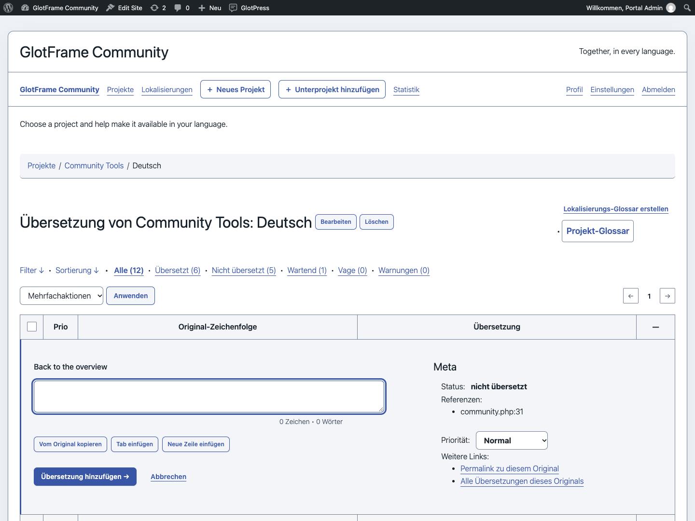
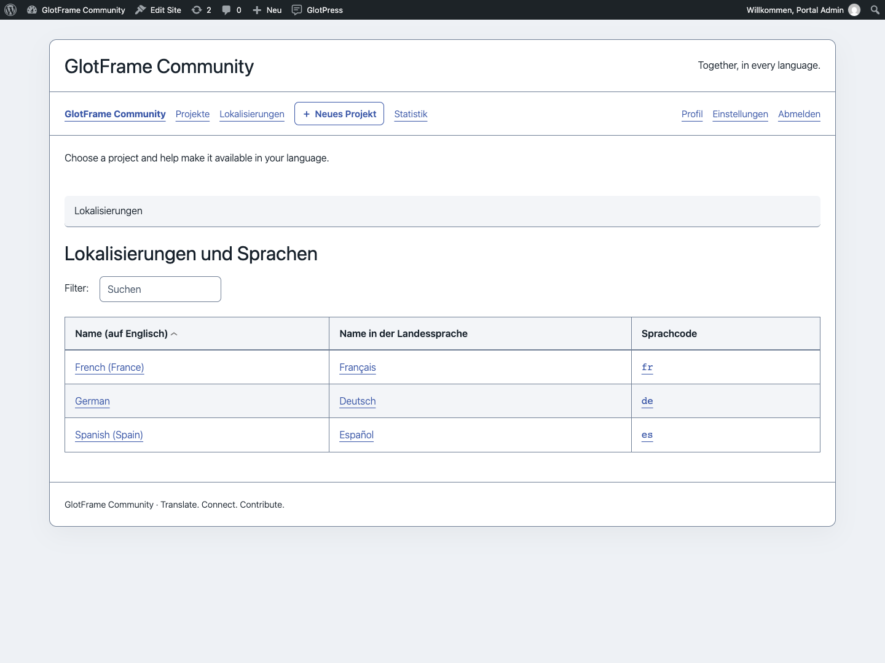
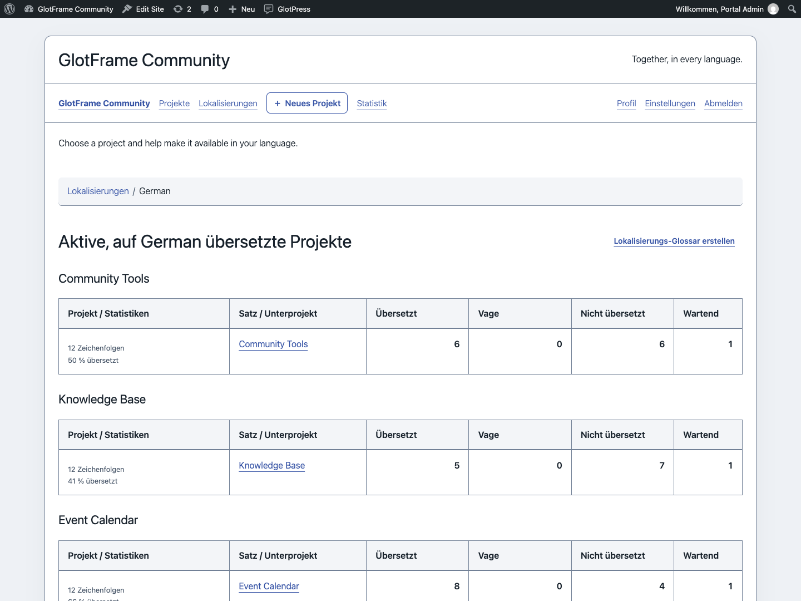
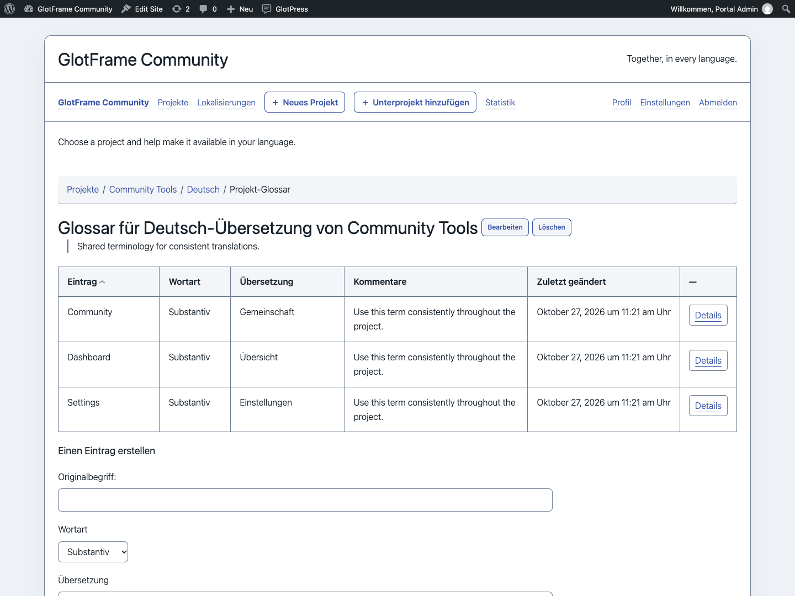

# Projekte und Übersetzung

[English](Projects-and-translation.md) · [Anleitung](GUIDE-de.md)

## Projekte finden

Stammprojekte und Unterprojekte erhalten Suche und Liste/Raster-Umschaltung. Die Suche filtert die angezeigte Sammlung; sie durchsucht keine Übersetzungsstrings. Die Ansichtspräferenz bleibt bei verfügbarem lokalem Speicher in diesem Browser erhalten. Beschreibungen und Bearbeitungslinks gehören weiterhin zum jeweiligen Projekt.

Die native Auswahl übergeordneter Projekte ist durchsuchbar und zeigt Projektpfade. So lassen sich gleichnamige Projekte in verschiedenen Zweigen unterscheiden. Ohne JavaScript bleiben die nativen GlotPress-Bedienelemente nutzbar.

## Aktionen und Editor

Berechtigte Benutzer erreichen Neues Projekt in der Navigation des Übersetzungsbereichs und der Toolbar. Beim aktuellen Projekt gibt es außerdem einen Unterprojekt-Link. Geöffnet werden die nativen GlotPress-Formulare mit ihren Berechtigungen und Eingabeprüfungen. Projektaktionen klappen unterhalb des Schalters auf und reservieren keine seitliche Spalte.

Übersetzungstabellen erhalten wechselnde Zeilenhintergründe, Hover-Rückmeldung, die kompakte Prio-Überschrift, feste Checkboxbreiten, angenehmere Innenabstände und getrennte Navigation, Legende und Exportfunktionen. Details und Abbrechen verwenden den nativen Editorablauf. Exportformate und Übersetzungsdaten bleiben unter Kontrolle von GlotPress.

## Sprachen und Glossare

Die Sprachübersicht hat ausgerichtete Spalten und den nativen Sprachfilter. Sprachbezogene Projekttabellen trennen Projektinformationen, Übersetzungssätze und Zahlen. Glossare zeigen Begriffe, Wortarten, Übersetzungen und Kommentare mit klareren Zeilenabständen. Berechtigungen und gespeicherte Glossareinträge werden nicht verändert.

## Deutsche Oberfläche mit Du oder Sie

Wähle unter **GlotPress-Oberflächensprache**: WordPress-Sprache übernehmen, Deutsch mit Du oder Deutsch mit Sie. Mitgelieferte offizielle GlotPress-4.1.0-Kataloge decken PHP und JavaScript ab. Die Auswahl betrifft nur GlotPress, weder den WordPress-Admin noch Projektübersetzungen. Unbekannte Texte von Erweiterungen oder anderen GlotPress-Versionen verwenden den nativen Fallback.

Beispiel aus einer lokalen Demo-Installation.

Beispiel aus einer lokalen Demo-Installation.

Beispiel aus einer lokalen Demo-Installation.

Beispiel aus einer lokalen Demo-Installation.

Beispiel aus einer lokalen Demo-Installation.

Beispiel aus einer lokalen Demo-Installation.

Beispiel aus einer lokalen Demo-Installation.

Beispiel aus einer lokalen Demo-Installation.

Beispiel aus einer lokalen Demo-Installation.

