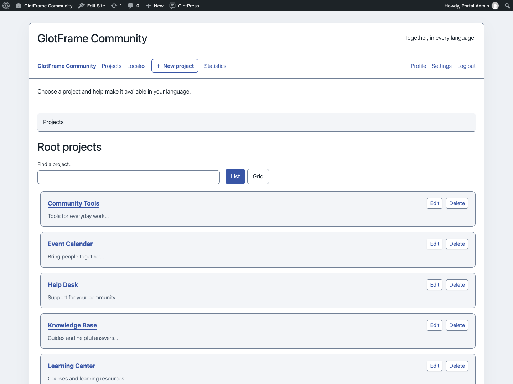
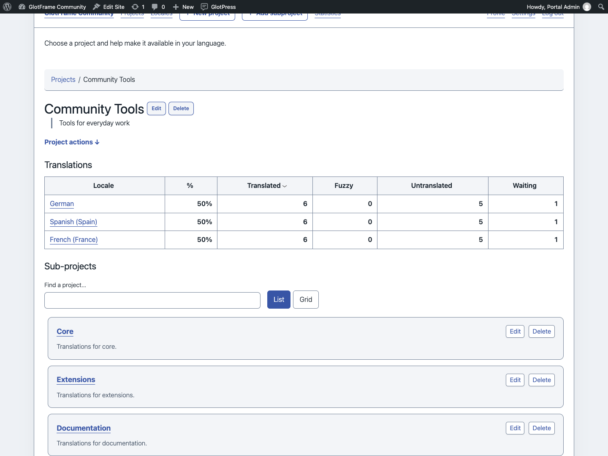
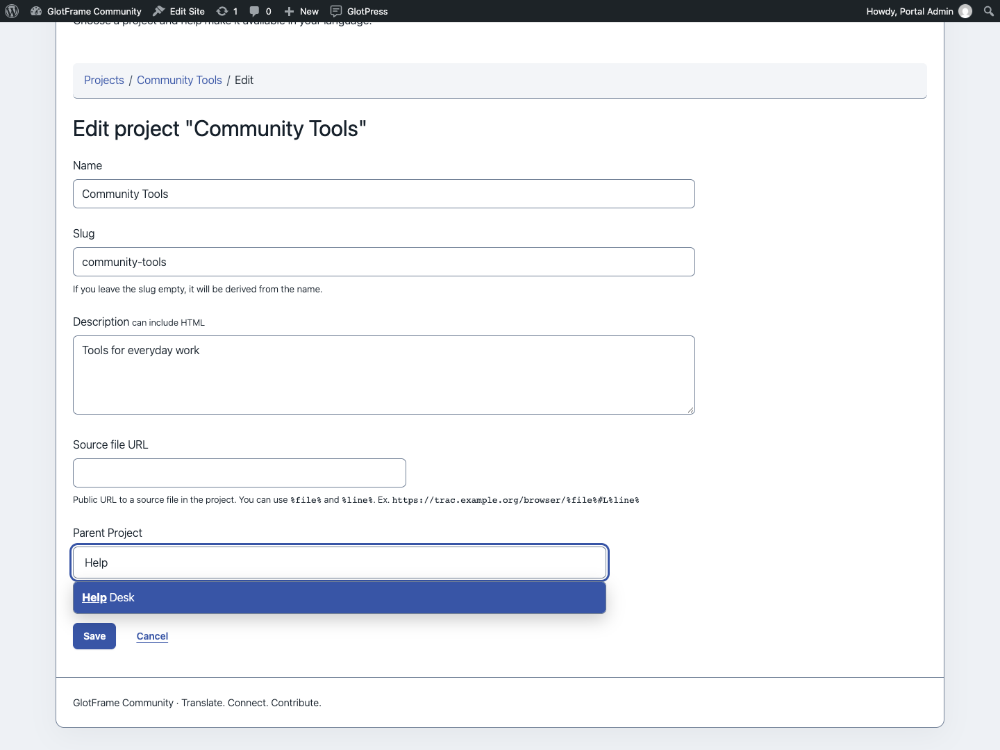
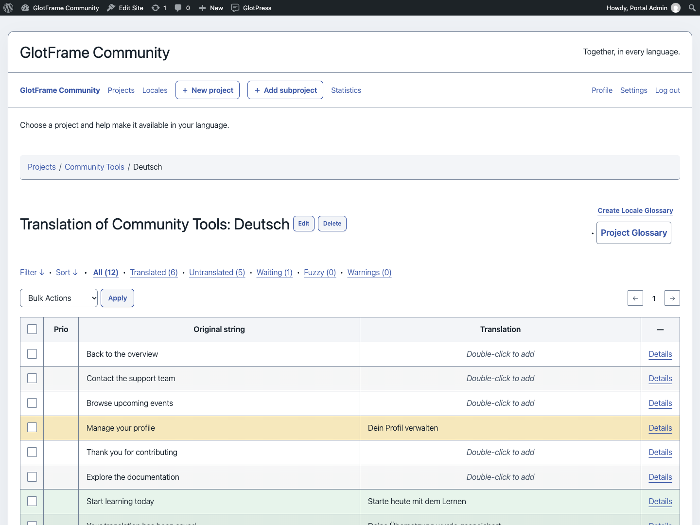
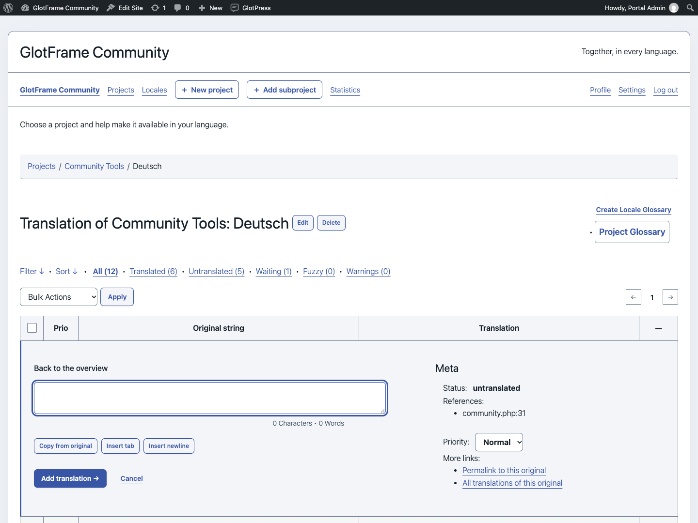
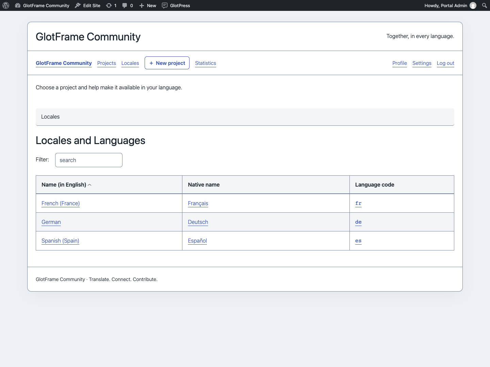
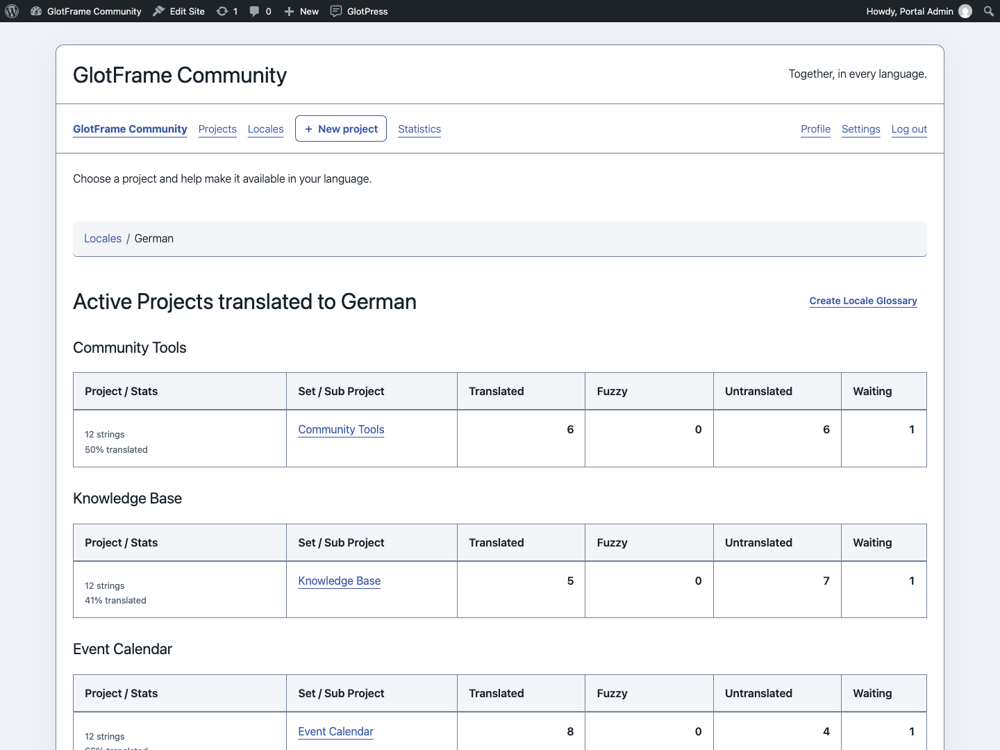
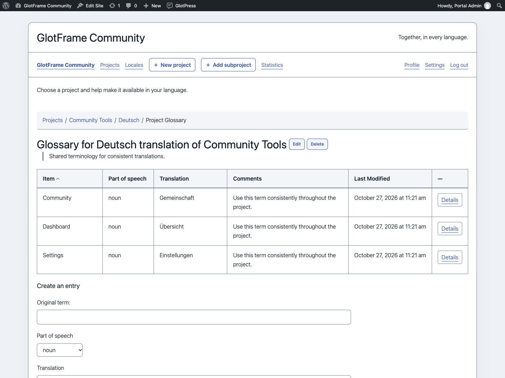

# Projects and translation

[Deutsch](Projects-and-translation-de.md) · [Guide](GUIDE.md)

## Find projects

Root projects and subprojects have a search field and List/Grid switch. Search filters the displayed collection; it is not a search across translation strings. Your view choice is retained in this browser when local storage is available. Project descriptions and edit links remain attached to their project.

The native parent-project selector is searchable and shows project paths. This helps distinguish repeated names in different branches. If JavaScript is unavailable, native GlotPress controls remain usable.

## Actions and editor

Authorized users can reach New project from the workspace navigation and the toolbar. The current project also offers a subproject shortcut. These links open native GlotPress forms, retaining its permission and validation rules. Project actions expand below their toggle and do not reserve a side column.

Translation tables use alternating rows and hover feedback, a compact Prio heading, defined checkbox widths, comfortable cell spacing and separated navigation, legend and export controls. Details and Cancel retain the native editor workflow. Export formats and translation data remain managed by GlotPress.

## Languages and glossaries

The language overview has aligned columns and its native language filter. Language-specific project tables distinguish project information, translation sets and counts. Glossaries show terms, parts of speech, translations and comments with clearer row spacing. GlotFrame does not change glossary permissions or stored entries.

## German informal and formal interface

Choose **GlotPress interface language** in the settings: inherit WordPress, German informal or German formal. Bundled official GlotPress 4.1.0 catalogs cover PHP and JavaScript. The choice affects the GlotPress interface only, not WordPress administration or project translations. Unknown strings from extensions or other GlotPress versions retain native fallback behavior.

Search root projects in list view.

Switch the root-project overview to grid view.

Find and browse the current project’s subprojects.

Search the parent-project selector while editing a project.

Translation table with alternating rows and separate controls.

Open Details to work on a translation.

Filter the aligned language overview.

Compare translation sets for a selected language.

Read consistent terminology and create glossary entries.
