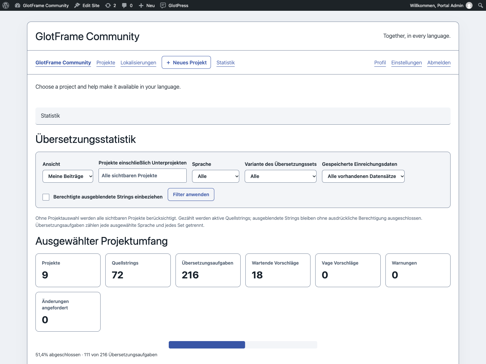

# Statistik

[English](Statistics.md) · [Anleitung](GUIDE-de.md)

Öffne **GlotFrame → Statistik** für die Betreiberübersicht. Angemeldete Übersetzer erreichen die Frontend-Statistik über Navigation oder Toolbar. Wähle eigene Beiträge oder Projektgruppen und grenze Projekte, Sprache und Übersetzungssatz ein. Ein gewähltes Projekt umfasst seine Unterprojekte.

Karten, Fortschrittsgrafik und Projekt-Sprach-Matrix zeigen den aktuellen Stand. Die Gesamtquote wird anhand der Ausgangsstrings pro Übersetzungssatz gewichtet, nicht aus Projektprozenten gemittelt. Ein Ausgangsstring in drei Sprachsätzen ergibt drei Übersetzungsaufgaben. Leere Projekte erzeugen keine irreführenden 100 %.

Wartende Vorschläge und Warnungen können andere Zahlen überlappen; sie sind keine zusätzlichen Tortenstücke. Standard sind aktive öffentliche Strings. Ausgeblendete Strings erfordern native GlotPress-Berechtigung.

Persönliche Beiträge zählen noch vorhandene, dem angemeldeten Benutzer zugeordnete Datensätze. Ihr Datumsfilter betrifft das gespeicherte Einreichungsdatum, nicht die Gesamtquote. Importe, überschriebene oder gelöschte Datensätze beeinflussen die Aussagekraft. Dies ist kein vollständiger Aktivitätsverlauf, Produktivitätswert oder Qualitätsranking.

Es entstehen keine Verlaufstabelle, Hintergrundverfolgung oder Analyseverbindung. Der Berechnungszeitpunkt wird angezeigt. Der Block Projektgruppenstatistik bringt eine kompakte Zusammenfassung der gewählten Gruppe in ein Layout.

Betreiberstatistik mit Filtern und Fortschrittsgrafik.

Statistik für angemeldete Übersetzer mit Projektgruppenfiltern.
