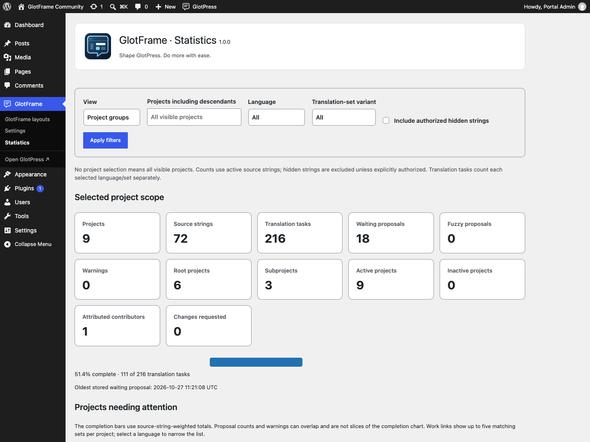
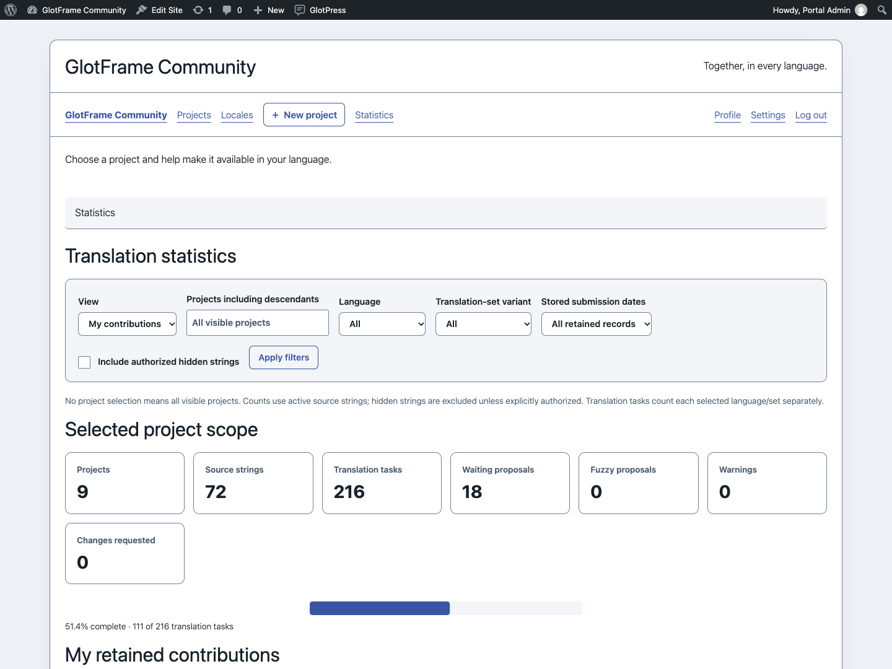

# Statistics

[Deutsch](Statistics-de.md) · [Guide](GUIDE.md)

Open **GlotFrame → Statistics** for the operator overview. Signed-in translators reach frontend statistics through workspace navigation or the toolbar. Choose your own contributions or project groups, then narrow projects, language and translation set. A selected project includes its descendants.

Cards, a completion graphic and a project-language comparison matrix show the current state. Overall completion is weighted by source strings per translation set, not the average of project percentages. One source string in three language sets creates three translation tasks. Empty projects do not produce a misleading 100%.

Waiting proposals and warnings can overlap other counts; they are not extra slices of completion. Public active strings are the default. Including hidden strings requires native GlotPress authorization.

Personal contributions count retained records attributed to the signed-in user. Their date filter applies to the stored submission date, not overall completion. Imports, overwritten or deleted records affect what the figures can represent. This is not a complete activity history, productivity score or quality ranking.

No history table, background tracking or analytics service is created. The calculation time is shown. The Project group statistics block places a compact summary of the selected group in a layout.

Example from a local demo installation.

Example from a local demo installation.

