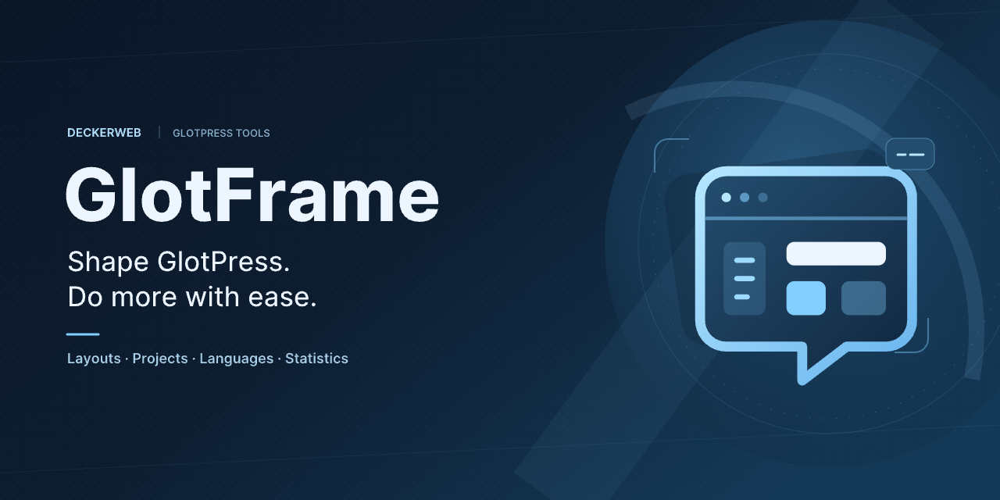
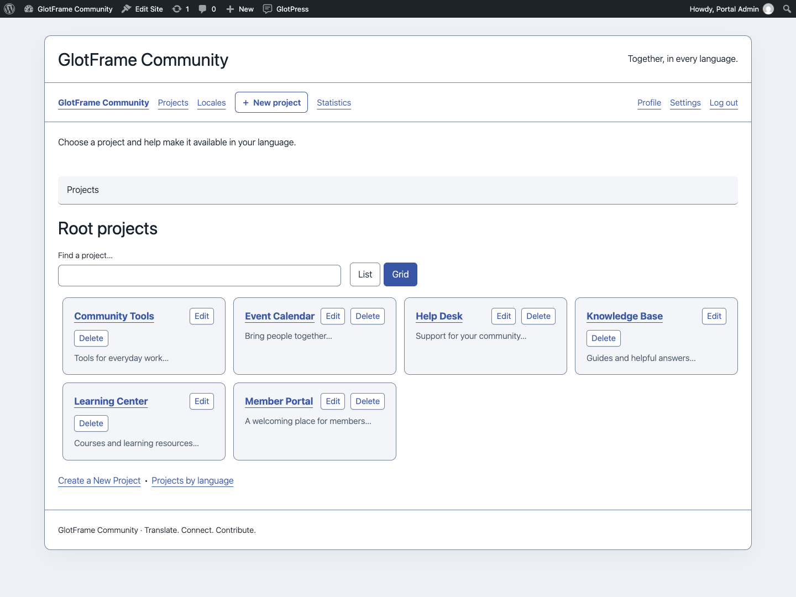
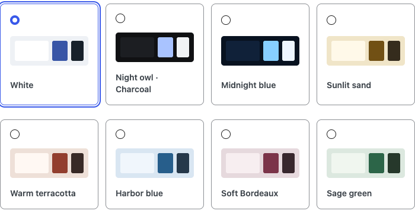

# GlotFrame

## About

GlotFrame turns GlotPress into a translation portal with its own identity and a clearer interface.

WordPress block headers and footers, coordinated designs, improved project views and useful statistics help translators find their way. Set it up directly in WordPress without writing custom PHP.

A deckerweb tool for anyone who wants to shape GlotPress more easily and use it more comfortably.

**Version 1.0.0** · WordPress 6.4+ · PHP 8.3+ · GlotPress 4.x

[Deutsch](https://github.com/deckerweb/glotframe/blob/main/README-de.md) · [Wiki](https://github.com/deckerweb/glotframe/wiki) · [Guide](https://github.com/deckerweb/glotframe/blob/main/docs/GUIDE.md) · [FAQ](https://github.com/deckerweb/glotframe/blob/main/docs/FAQ.md)

Contents: [About](#about) · [At a Glance](#at-a-glance) · [Getting started](#getting-started) · [Feature highlights](#feature-highlights) · [Frequently asked questions](#frequently-asked-questions) · [Screenshots](#screenshots) · [Changelog](#changelog)

## At a Glance

- Build headers and footers with WordPress blocks
- A design that fits your identity
- Keep large project collections organized
- Fewer steps in everyday translation work
- Use GlotPress as your translation portal
- See translation progress at a glance
- German with informal or formal address
- Convenient administration, including Multisite

## Getting started

1. Check **WordPress 6.4+**, **PHP 8.3+** and **GlotPress 4.x**. Choose a readable permalink structure in **Settings → Permalinks**; Plain is not supported by GlotPress.
2. Install the GlotFrame ZIP through **Plugins → Add Plugin → Upload Plugin** and activate it. Use the packaged ZIP supplied with a release, rather than GitHub’s automatic source archive.
3. Open **GlotFrame → Settings**. The three jump links lead to Frontend & Layout, Admin & Toolbar, and Data & System.
4. Beside the content assignments, choose **Create block layout**. Add blocks, give the layout a title and publish it. Create separate layouts for the header and footer if needed.
5. Select the published layouts under Header, footer and content. Choose a preset, width and spacing. Enable GlotFrame and save.
6. Use **View GlotPress** and check the project list, an individual language and the translation editor, including on a small screen.

GlotFrame can be installed and activated without GlotPress. You can prepare and save settings and layouts. Dependent frontend functions pause, an admin notice explains why, and stored data is preserved. They resume automatically when GlotPress 4.x and readable permalinks are available. There is no activation redirect out of the administration area.

## Feature highlights

### Build headers and footers with WordPress blocks

Design headers, footers and notice areas in the block editor. Seven starting patterns and five dynamic GlotPress blocks help you build your own layouts.

### A design that fits your identity

Choose boxed or full-width layouts, eight color presets, custom colors and background images. Give your workspace coordinated forms, buttons and readable tables.

### Keep large project collections organized

Search root projects and subprojects and switch between list and grid views. A searchable parent-project selector makes long project lists easier to navigate.

### Fewer steps in everyday translation work

A configurable toolbar links to projects and subprojects. Authorized users can reach the native forms for new projects and subprojects directly from the navigation.

### Use GlotPress as your translation portal

Optionally use GlotPress as the homepage and choose its URL path. Headers, footers and additional content give your portal its own identity.

### See translation progress at a glance

Metrics, charts and project comparisons show the current state. Operators get an overview, while signed-in translators can review their own contributions and selected project groups.

### German with informal or formal address

Choose informal or formal German for the GlotPress interface. The WordPress administration language and actual project translations remain independent.

### Convenient administration, including Multisite

Duplicate layouts, save changes conveniently and use Site Health and the native Command Palette. Each Multisite website keeps its own settings and layouts.

## Frequently asked questions

### Do I need GlotPress?

Yes. The translation workspace requires active GlotPress 4.x and readable permalinks. GlotFrame can still be activated without GlotPress. Prepare and save settings and layouts while dependent features pause.

### How do I create headers and footers?

Open GlotFrame → Settings → Header, footer and content. Create block layouts, publish them and assign them to the desired regions.

### Does it work with my theme or page builder?

GlotFrame provides its own frame using WordPress blocks. Content created with Bricks, Elementor or other page builders is not supported as GlotFrame layouts.

### Does GlotFrame change my translations?

No. Projects, translations, permissions, forms, downloads and API responses remain managed by GlotPress.

### What do the statistics mean?

They show current translation tasks and retained contribution records. Project completion is weighted. They are not a complete activity history or quality ranking.

### Does GlotFrame support Multisite?

Yes. Each website manages its own settings and layouts, including with network activation.

### What happens when I deactivate or delete it?

Deactivation preserves all data. Deletion preserves settings and layouts by default. Optional deletion affects GlotFrame content only; GlotPress data is retained.

[Complete FAQ by topic](https://github.com/deckerweb/glotframe/blob/main/docs/FAQ.md).

## Screenshots

Switch the root-project overview to grid view.

Choose from eight coordinated color presets.

Operator statistics with filters and completion graphic.

## Changelog

### 1.0.0

- **New:** Initial release: block headers, footers and notice areas; seven layout patterns and five dynamic GlotPress blocks; boxed and full-width layouts with eight color presets, custom colors and backgrounds.
- **Improved:** Searchable project lists and grids, searchable parent-project selection, clearer translation and glossary tables, configurable toolbar navigation and placement, and optional portal homepage and URL path.
- **Misc:** Includes German informal and formal interface translations, current operator and personal statistics, layout management shortcuts, Site Health information and contextual WordPress Command Palette actions. Requires WordPress 6.4, PHP 8.3 and active GlotPress 4.x for workspace features; settings and layouts remain available when GlotPress is absent.

## Roots in 2017. Now united in one plugin.

GlotFrame’s roots go back to 2017. Practical work with GlotPress led to a collection of code snippets and custom templates: more design options, clearer navigation and a more comfortable translation workflow.

Useful as they were, those individual pieces took considerable effort to maintain. Each GlotPress update meant checking what still worked and what needed adjusting.

Today, GlotFrame brings those original ideas together in a fully integrated WordPress plugin and takes them further. What once required individual code changes is now a tool that helps people without programming experience, site builders and translation editors quickly create a beautiful, easy-to-use translation portal.

GlotPress provides translation management. GlotFrame adds what is often still needed for a distinctive portal and a comfortable working day: design, orientation and many thoughtful details, all in one package.

[Issues and questions](https://github.com/deckerweb/glotframe/issues) · [Discussions](https://github.com/deckerweb/glotframe/discussions) · [Private security reporting](https://github.com/deckerweb/glotframe/blob/main/SECURITY.md)

[Ko-fi](https://ko-fi.com/deckerweb) · [Buy Me a Coffee](https://buymeacoffee.com/daveshine) · [PayPal](https://paypal.me/deckerweb)

Copyright © 2017–2026 David Decker – DECKERWEB. Plugin license: GPL v2 or later. [Third-party notices](https://github.com/deckerweb/glotframe/blob/main/THIRD-PARTY.md).
